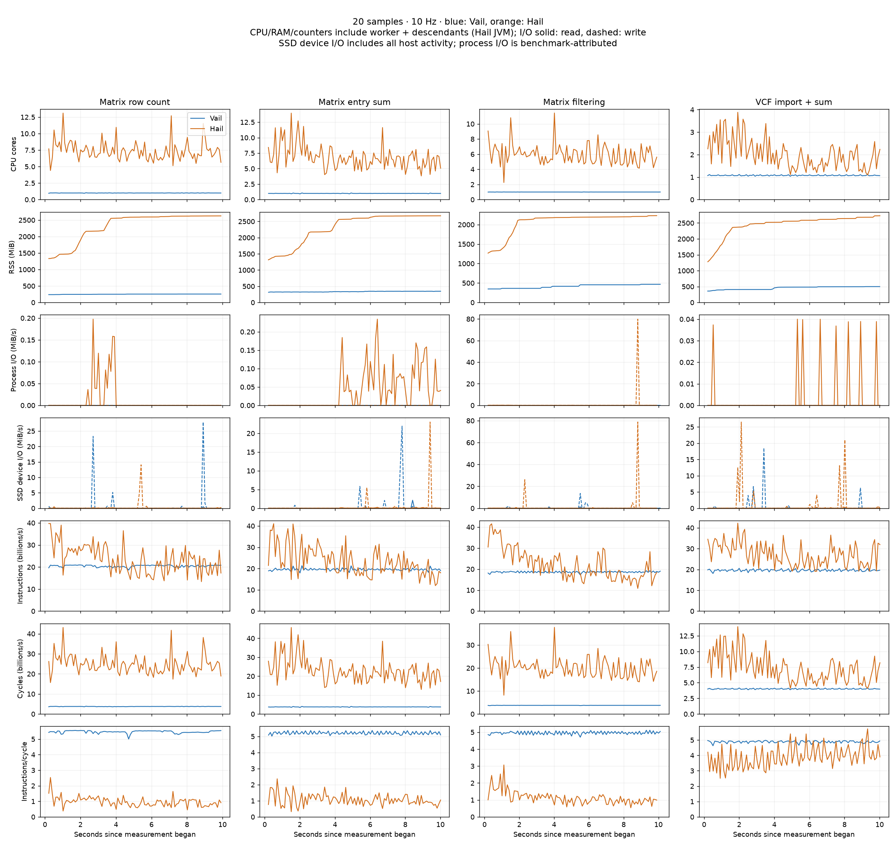

# 20-sample Hail/Vail resource telemetry

Eight serialized captures: 100,000 Matrix rows × 20 samples, or 50,000 VCF variants × 20 samples. Each starts a fresh engine, performs three warmups, then repeats fresh lazy queries for at least ten seconds. Every query checks the same result as the benchmark harness. No forced garbage collection occurs between queries. These sustained-run medians can differ from the earlier five-iteration run.

The independent monitor samples at a target 10 Hz. CPU, RAM, disk I/O, instructions and cycles sum the Python worker and descendants, including Hail's JVM. RAM is summed RSS (shared pages can be counted in multiple processes); physical footprint is also retained in the CSV. One CPU core is one fully occupied core. Hail uses Spark local[14] and a 48 GiB max heap; Vail uses the established release wheel.

SSD activity is read from the APPLE SSD IOBlockStorageDriver device statistics. It includes other applications and the monitor's small coordination writes; it cannot be attributed to the benchmark. Process disk I/O is listed separately. Warm cached VCF reads may generate no physical I/O. Cache-miss counters are not exposed by proc_pid_rusage V4.

Only complete sample intervals inside the measured phase contribute to summaries. CPU mean is time-weighted, RSS is the largest sampled value, and instructions/query and CPU seconds/query are estimates from measured rates divided by query throughput. Raw timestamps, instructions/cycles, sampling intervals and collector overhead are retained. The traces show rates during equal-duration windows; faster engines complete more queries.

| Workload | Engine | Median/query (s) | Mean CPU cores | Peak RSS (MiB) | CPU s/query | Billion instructions/query | IPC | Process read/write (MiB) | SSD read/write (MiB) |
|---|---|---:|---:|---:|---:|---:|---:|---:|---:|
| Matrix row count | vail | 0.0053 | 1.00 | 256 | 0.0053 | 0.11 | 5.47 | 0.00/0.00 | 0.06/6.07 |
| Matrix row count | hail | 0.0455 | 7.42 | 2626 | 0.3826 | 1.21 | 0.95 | 0.11/0.00 | 0.14/1.99 |
| Matrix entry sum | vail | 0.1655 | 1.00 | 347 | 0.1658 | 3.24 | 5.21 | 0.00/0.00 | 0.22/4.36 |
| Matrix entry sum | hail | 0.0711 | 6.87 | 2674 | 0.5568 | 1.90 | 1.02 | 0.39/0.00 | 0.41/2.98 |
| Matrix filtering | vail | 0.1990 | 1.00 | 466 | 0.1995 | 3.71 | 4.96 | 0.00/0.00 | 0.16/2.71 |
| Matrix filtering | hail | 0.0826 | 5.95 | 2230 | 0.5470 | 2.03 | 1.10 | 0.21/8.00 | 0.23/11.38 |
| VCF import + sum | vail | 0.0803 | 1.08 | 500 | 0.0865 | 1.58 | 4.88 | 0.00/0.00 | 0.05/3.72 |
| VCF import + sum | hail | 0.1451 | 2.01 | 2728 | 0.3014 | 4.08 | 3.73 | 0.03/0.00 | 0.12/8.86 |

The comparison CSV includes cycles/query, physical footprint and repetition/sample counts. Each case directory contains worker.json with query boundaries/provenance, metrics.csv with interval traces, and summary.json with process IDs, SSD counters and sampling-quality statistics. run.log contains engine diagnostics.
