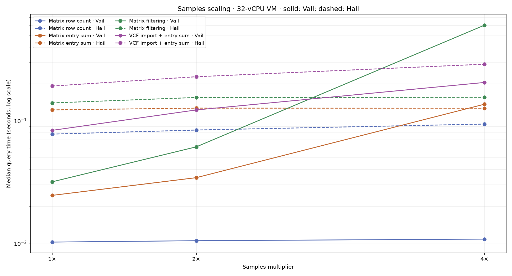
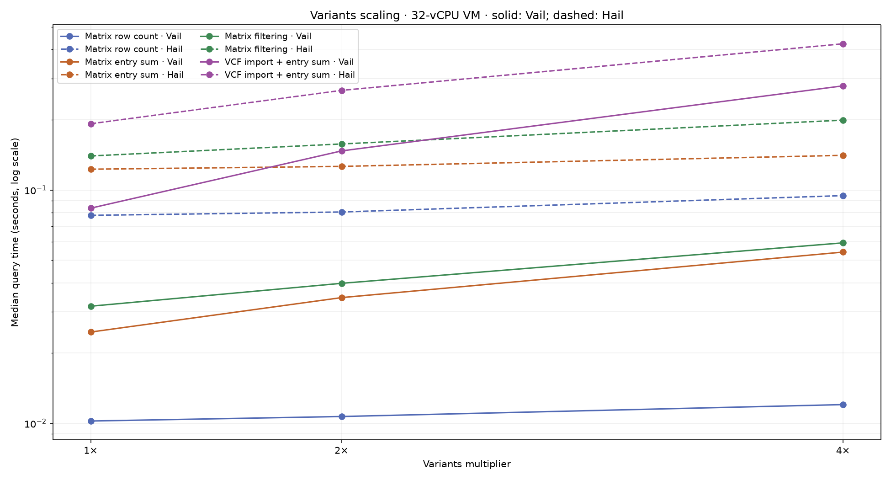
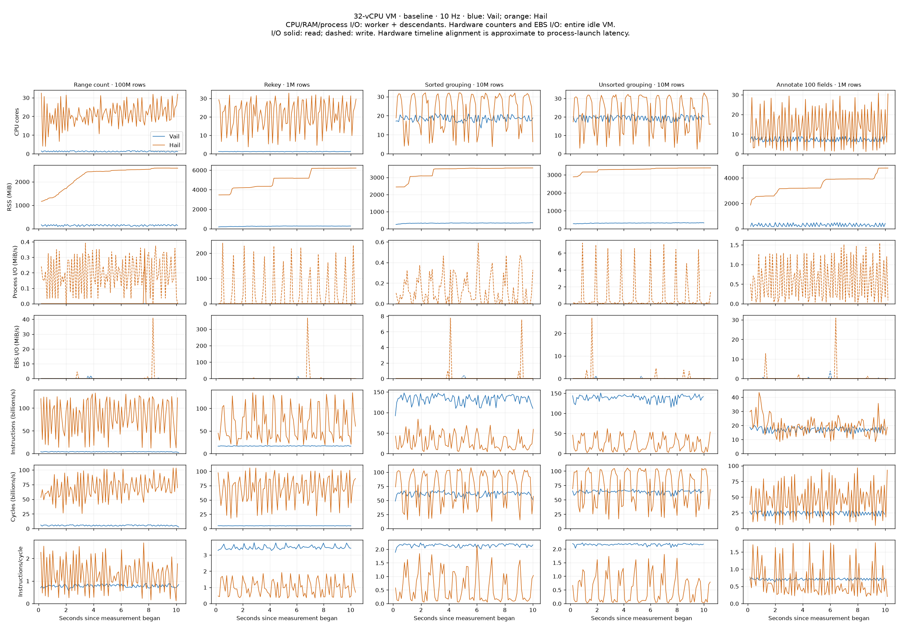
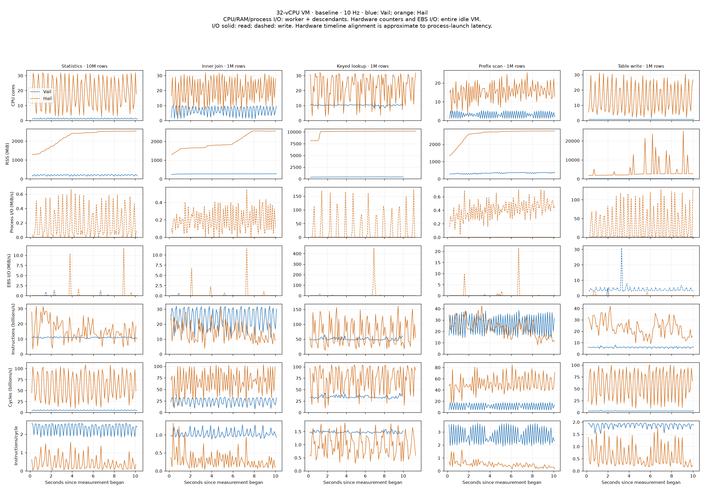
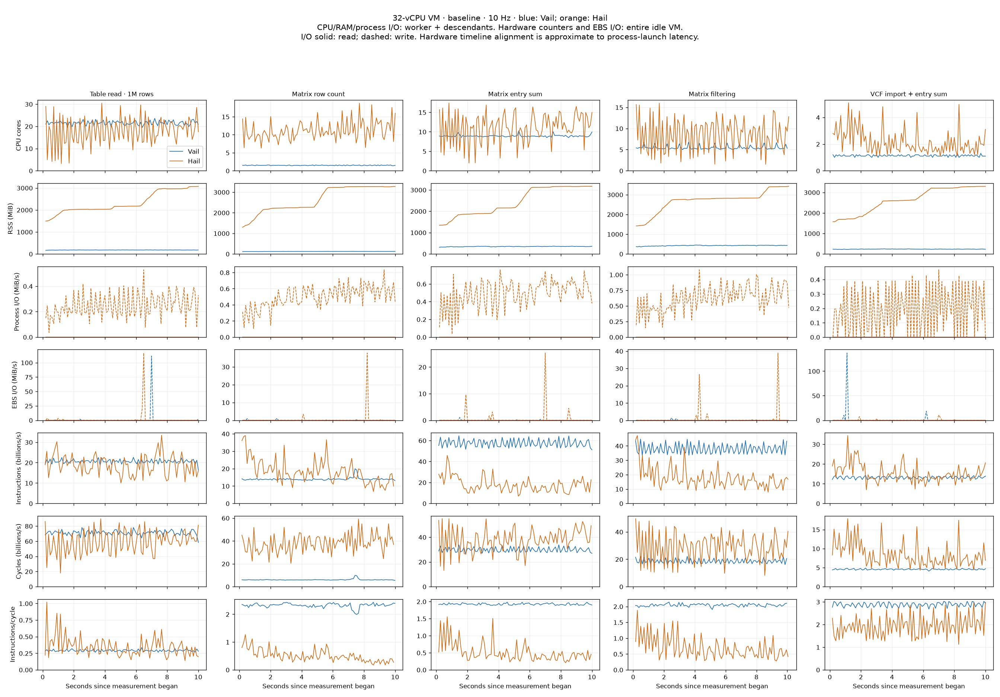
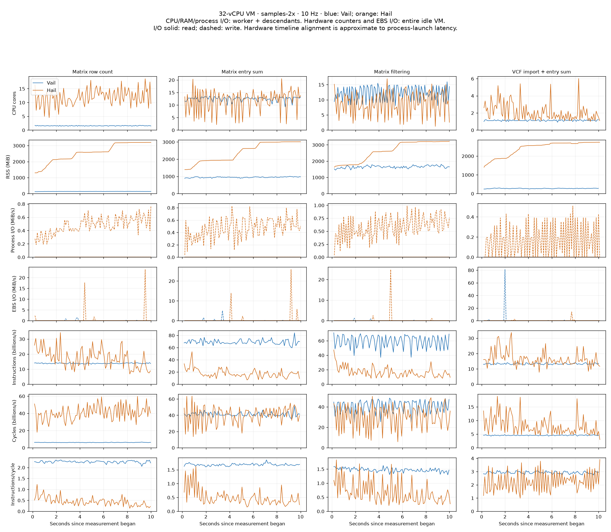
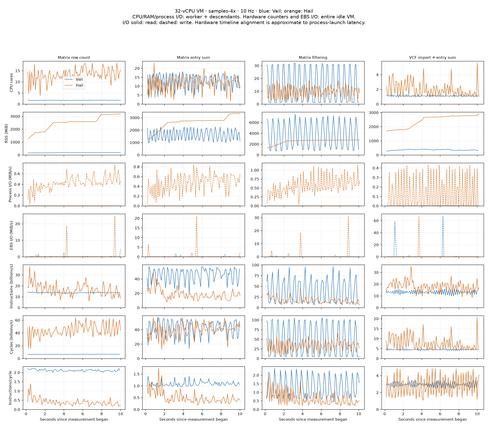
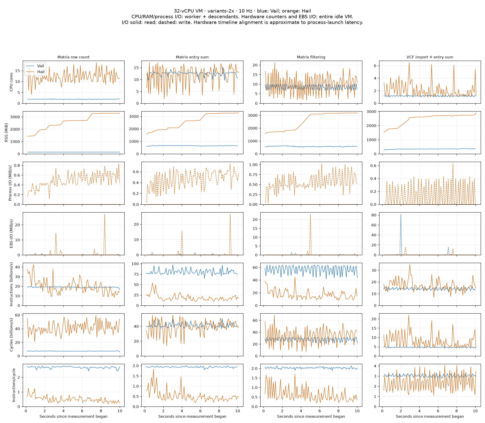
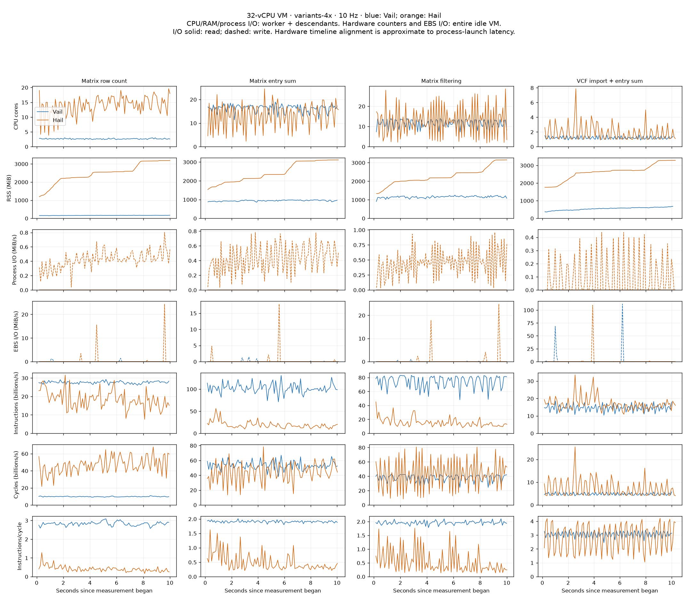

# Cloud Hail/Vail benchmarks

AWS m7i.8xlarge, Ubuntu 22.04, 32 vCPUs (16 cores × 2 SMT threads), 128 GiB RAM, 200 GiB gp3 EBS. Both engines use Python 3.11.17. Synthetic sources request 32 partitions; Vail has 32 runtime workers and Hail uses Spark local[32] with a 64 GiB heap. Stock Hail is installed from PyPI; Vail is built with --release --locked and target-cpu=native, using Rust 1.98.0.

All runs execute serially on the otherwise idle VM after compilation. Each has three warmups and at least ten measured seconds of fresh lazy queries. Result-bearing workloads assert their results every iteration; writing is also exercised by the separately checked read workload. Totals sum per-case medians (one invocation of each case), excluding startup/warmups. Raw iterations, 10 Hz traces, perf output, script hashes, configuration, and elapsed wall time are retained.

## Complete 15-case baseline

| Benchmark | Vail (s) | Hail (s) | Hail/Vail |
|---|---:|---:|---:|
| Range count · 100M rows | 0.192205 | 0.173734 | 0.90× |
| Rekey · 1M rows | 0.123109 | 0.672724 | 5.46× |
| Sorted grouping · 10M rows | 0.027709 | 0.908831 | 32.80× |
| Unsorted grouping · 10M rows | 0.026730 | 0.924552 | 34.59× |
| Annotate 100 fields · 1M rows | 0.042261 | 0.246048 | 5.82× |
| Statistics · 10M rows | 0.314541 | 0.397804 | 1.26× |
| Inner join · 1M rows | 0.148908 | 0.251823 | 1.69× |
| Keyed lookup · 1M rows | 0.101052 | 1.619464 | 16.03× |
| Prefix scan · 1M rows | 0.207151 | 0.173145 | 0.84× |
| Table write · 1M rows | 0.406700 | 0.341615 | 0.84× |
| Table read · 1M rows | 0.018671 | 0.148782 | 7.97× |
| Matrix row count | 0.010226 | 0.077862 | 7.61× |
| Matrix entry sum | 0.024611 | 0.122739 | 4.99× |
| Matrix filtering | 0.031761 | 0.139912 | 4.41× |
| VCF import + entry sum | 0.083582 | 0.192289 | 2.30× |
| **Total** | **1.759216** | **6.391325** | **3.63×** |

Summing all 31 distinct workload configurations (the baseline is counted once): Vail **3.582104 s**, Hail **9.141991 s**.

## Scaling totals

The four Matrix/VCF cases have sample/variant dimensions. 1× is 10 samples, 100,000 Matrix rows and 50,000 VCF variants; one dimension changes at a time. The two series share their 1× baseline. Table-only workloads are measured in the full baseline above.

| Dimension | Scale | Vail total (s) | Hail total (s) | Hail/Vail |
|---|---:|---:|---:|---:|
| samples | 1× | 0.150180 | 0.532802 | 3.55× |
| samples | 2× | 0.228793 | 0.595138 | 2.60× |
| samples | 4× | 0.956952 | 0.666275 | 0.70× |
| variants | 1× | 0.150180 | 0.532802 | 3.55× |
| variants | 2× | 0.232117 | 0.631418 | 2.72× |
| variants | 4× | 0.405026 | 0.857835 | 2.12× |

## Samples medians

| Benchmark | Vail 1× | Hail 1× | Vail 2× | Hail 2× | Vail 4× | Hail 4× |
|---|---:|---:|---:|---:|---:|---:|
| Matrix row count | 0.010226 | 0.077862 | 0.010494 | 0.084081 | 0.010816 | 0.094065 |
| Matrix entry sum | 0.024611 | 0.122739 | 0.034338 | 0.126952 | 0.136643 | 0.126751 |
| Matrix filtering | 0.031761 | 0.139912 | 0.061289 | 0.155063 | 0.603842 | 0.155598 |
| VCF import + entry sum | 0.083582 | 0.192289 | 0.122671 | 0.229041 | 0.205651 | 0.289860 |

## Variants medians

| Benchmark | Vail 1× | Hail 1× | Vail 2× | Hail 2× | Vail 4× | Hail 4× |
|---|---:|---:|---:|---:|---:|---:|
| Matrix row count | 0.010226 | 0.077862 | 0.010691 | 0.080465 | 0.012025 | 0.094587 |
| Matrix entry sum | 0.024611 | 0.122739 | 0.034569 | 0.126207 | 0.054177 | 0.140741 |
| Matrix filtering | 0.031761 | 0.139912 | 0.039803 | 0.157511 | 0.059339 | 0.199204 |
| VCF import + entry sum | 0.083582 | 0.192289 | 0.147054 | 0.267235 | 0.279485 | 0.423303 |

## Telemetry

CPU/RAM/process I/O include the worker and its descendants, including the Hail JVM. RSS may double-count shared pages. Hardware counters include the entire guest and the monitor; EBS rates are for the VM's virtual block device, not physical SSD hardware. Only full intervals within measurement contribute to plots and summaries. Hardware interval alignment includes small process-launch latency.

The local attempt was discarded after unrelated compilation caused CPU contention. The cloud write capture was retried after the monitor encountered a procfs permission race on a short-lived helper. Completed captures were retained; failed captures do not contribute to totals. Subsequent captures record unreadable descendant PIDs explicitly in summary.json. The primary worker is never silently skipped. Process-tree snapshots can miss short-lived helpers, so Hail write's process CPU/RSS/I/O measurements are approximate; guest-wide hardware counters include those helpers.

The virtual PMU reported zero cache misses in every capture. Do not interpret that as evidence of no cache misses; the raw counts are retained, but this counter is not used for performance conclusions.

The VM was terminated after all result bundles were downloaded; the temporary security group and key pair were removed. The scratch EBS volume was configured for deletion on termination.
