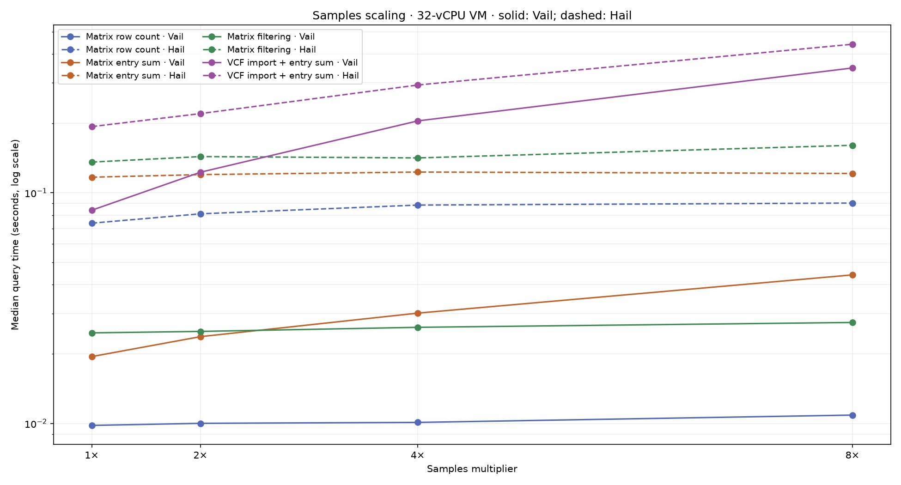
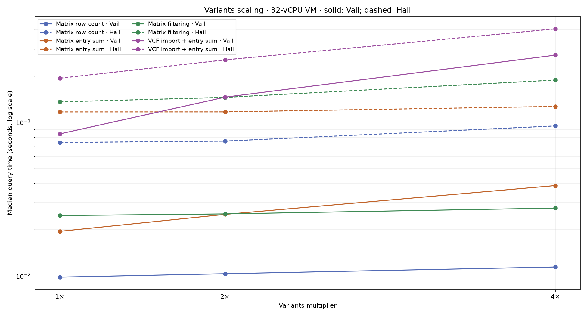
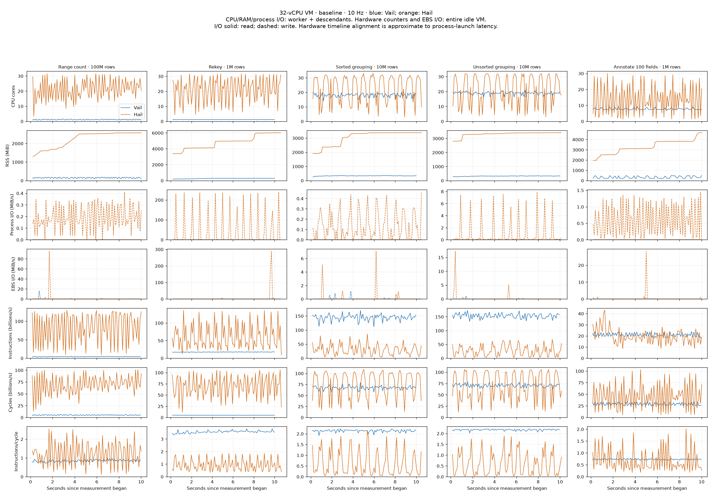
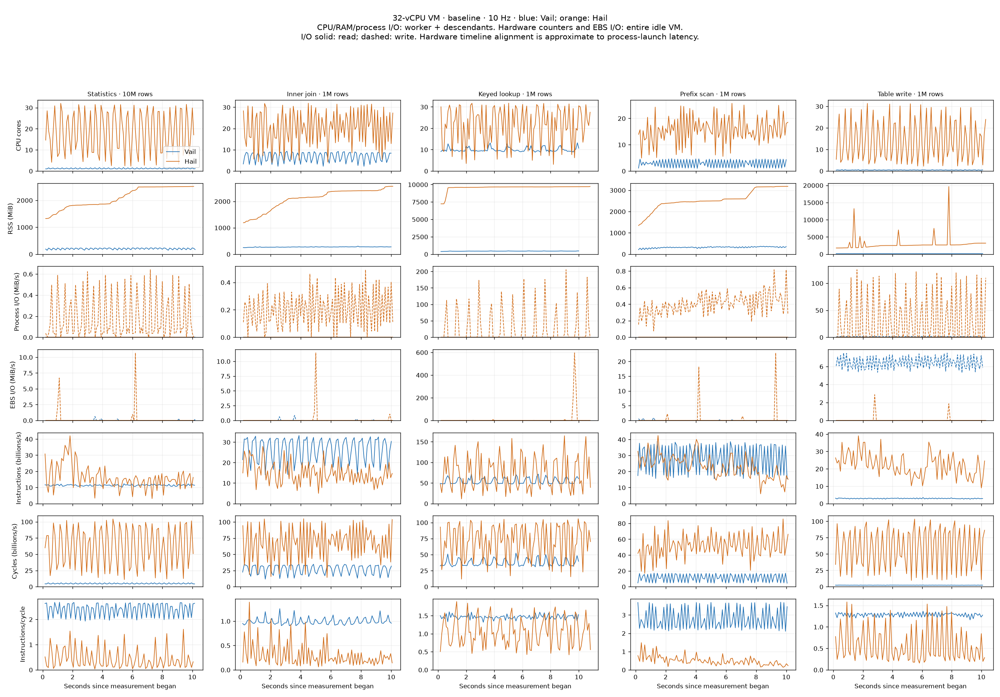
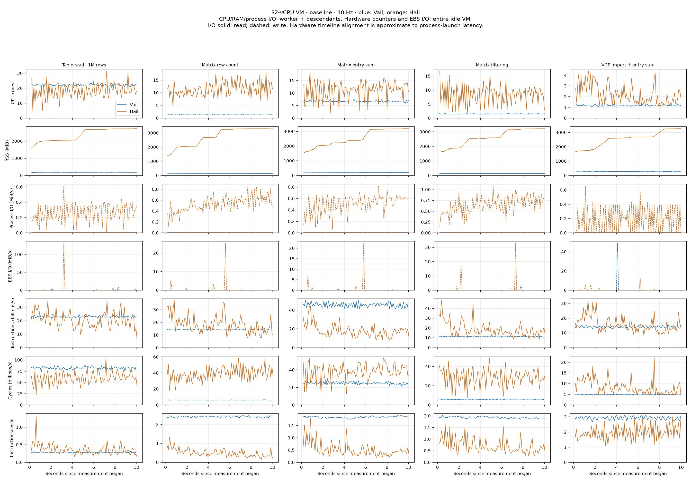
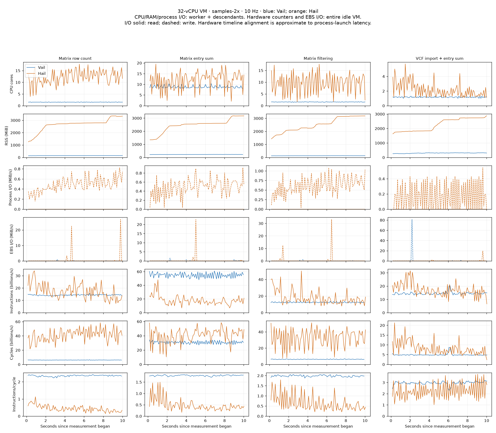
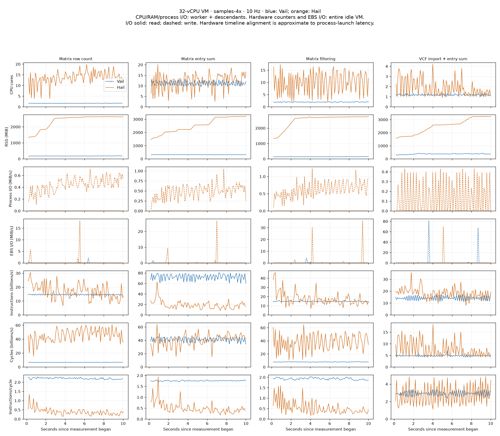
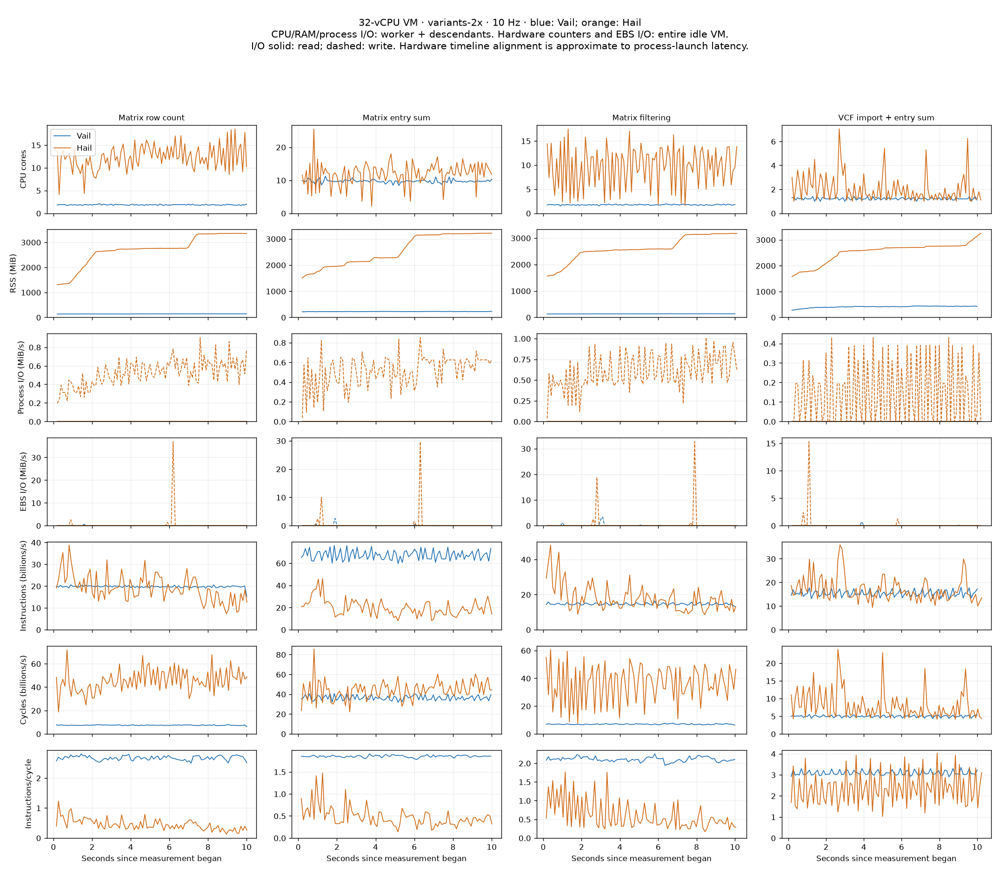
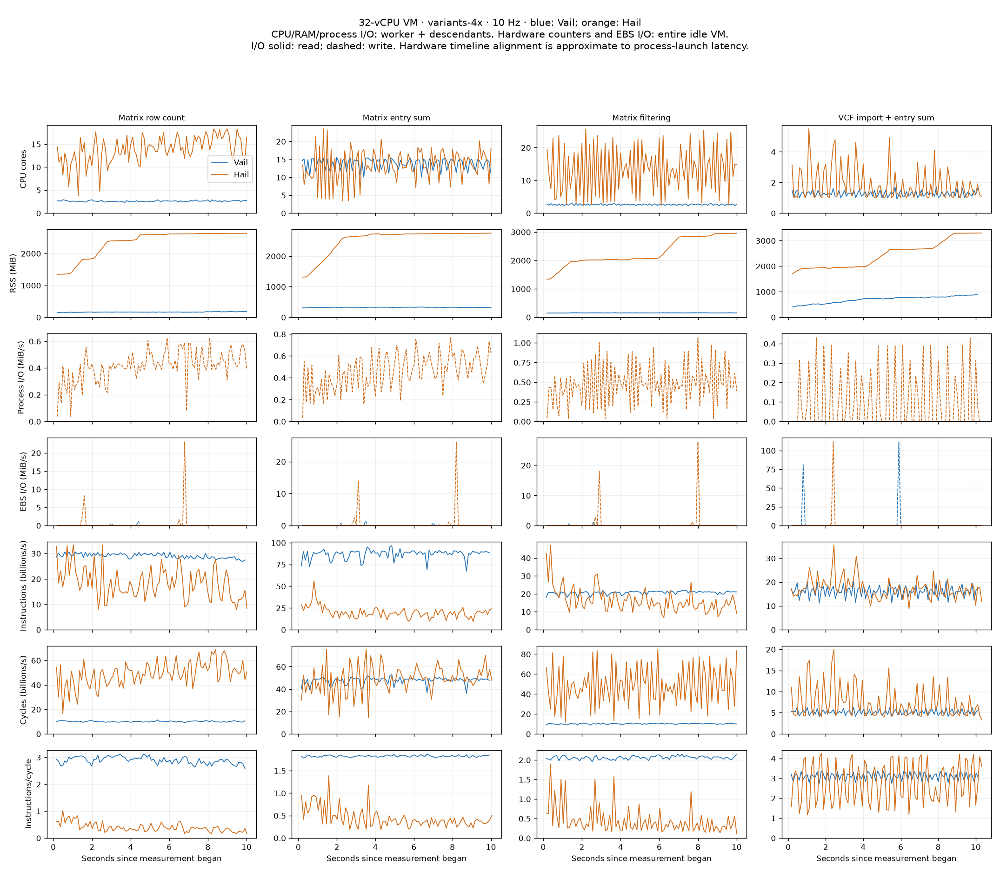
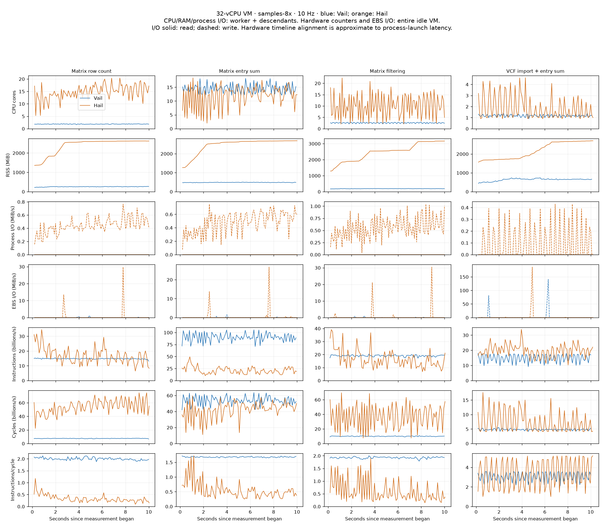

# Cloud Hail/Vail benchmarks

AWS m7i.8xlarge, Ubuntu 22.04, 32 vCPUs (16 cores × 2 SMT threads), 128 GiB RAM, 200 GiB gp3 EBS. Both engines use Python 3.11.17. Synthetic sources request 32 partitions; Vail has 32 runtime workers and Hail uses Spark local[32] with a 64 GiB heap. Stock Hail is installed from PyPI; Vail is built with --release --locked and target-cpu=native, using Rust 1.98.0.

All runs execute serially on the otherwise idle VM after compilation. Each has three warmups and at least ten measured seconds of fresh lazy queries. Result-bearing workloads assert their results every iteration; writing is also exercised by the separately checked read workload. Totals sum per-case medians (one invocation of each case), excluding startup/warmups. Raw iterations, 10 Hz traces, perf output, script hashes, configuration, and elapsed wall time are retained.

Vail revision: **`bfe917a3e42448b0963555f2db81ade54cb0367f`**. This final release passed 43 Linux regression tests before the 35 Vail captures. The 35 Hail captures are retained from the earlier completed run on the same AWS instance and instance type, with identical reported Intel Xeon 8488C CPU/topology; Hail 0.2.139 and the benchmark scripts are unchanged. The VM was stopped and restarted between runs, so this does not assert identical physical host placement.

The first final Vail capture failed before measurement because performance-counter permissions reset on restart; it was retried after restoring access. Only successful captures contribute to results. Measured Vail capture wall time was 397.7 seconds, excluding compilation and regression testing. The VM was terminated after download; its root volume, security group and key pair were removed.

## Complete 15-case baseline

| Benchmark | Vail (s) | Hail (s) | Hail/Vail |
|---|---:|---:|---:|
| Range count · 100M rows | 0.261795 | 0.170742 | 0.65× |
| Rekey · 1M rows | 0.117836 | 0.693918 | 5.89× |
| Sorted grouping · 10M rows | 0.025263 | 0.870252 | 34.45× |
| Unsorted grouping · 10M rows | 0.024217 | 0.872332 | 36.02× |
| Annotate 100 fields · 1M rows | 0.031976 | 0.246818 | 7.72× |
| Statistics · 10M rows | 0.300745 | 0.387772 | 1.29× |
| Inner join · 1M rows | 0.135349 | 0.236152 | 1.74× |
| Keyed lookup · 1M rows | 0.093139 | 1.554489 | 16.69× |
| Prefix scan · 1M rows | 0.195266 | 0.175153 | 0.90× |
| Table write · 1M rows | 0.218718 | 0.352681 | 1.61× |
| Table read · 1M rows | 0.016801 | 0.141670 | 8.43× |
| Matrix row count | 0.009803 | 0.073876 | 7.54× |
| Matrix entry sum | 0.019496 | 0.116910 | 6.00× |
| Matrix filtering | 0.024703 | 0.135951 | 5.50× |
| VCF import + entry sum | 0.084085 | 0.193759 | 2.30× |
| **Total** | **1.559192** | **6.222475** | **3.99×** |

Summing all 35 distinct workload configurations (the baseline is counted once): Vail **3.001087 s**, Hail **9.657717 s**.

## Scaling totals

The four Matrix/VCF cases have sample/variant dimensions. 1× is 10 samples, 100,000 Matrix rows and 50,000 VCF variants; one dimension changes at a time. The two series share their 1× baseline. Table-only workloads are measured in the full baseline above.

| Dimension | Scale | Vail total (s) | Hail total (s) | Hail/Vail |
|---|---:|---:|---:|---:|
| samples | 1× | 0.138087 | 0.520496 | 3.77× |
| samples | 2× | 0.181742 | 0.565373 | 3.11× |
| samples | 4× | 0.271459 | 0.646892 | 2.38× |
| samples | 8× | 0.430372 | 0.813512 | 1.89× |
| variants | 1× | 0.138087 | 0.520496 | 3.77× |
| variants | 2× | 0.206594 | 0.592841 | 2.87× |
| variants | 4× | 0.351729 | 0.816623 | 2.32× |

## Samples medians

| Benchmark | Vail 1× | Hail 1× | Vail 2× | Hail 2× | Vail 4× | Hail 4× | Vail 8× | Hail 8× |
|---|---:|---:|---:|---:|---:|---:|---:|---:|
| Matrix row count | 0.009803 | 0.073876 | 0.010008 | 0.081119 | 0.010102 | 0.088501 | 0.010867 | 0.090292 |
| Matrix entry sum | 0.019496 | 0.116910 | 0.023786 | 0.119973 | 0.030089 | 0.123070 | 0.044076 | 0.121365 |
| Matrix filtering | 0.024703 | 0.135951 | 0.025061 | 0.143626 | 0.026109 | 0.141723 | 0.027407 | 0.160776 |
| VCF import + entry sum | 0.084085 | 0.193759 | 0.122887 | 0.220656 | 0.205159 | 0.293599 | 0.348022 | 0.441078 |

## Variants medians

| Benchmark | Vail 1× | Hail 1× | Vail 2× | Hail 2× | Vail 4× | Hail 4× |
|---|---:|---:|---:|---:|---:|---:|
| Matrix row count | 0.009803 | 0.073876 | 0.010321 | 0.075472 | 0.011422 | 0.094728 |
| Matrix entry sum | 0.019496 | 0.116910 | 0.025138 | 0.116946 | 0.038728 | 0.126917 |
| Matrix filtering | 0.024703 | 0.135951 | 0.025311 | 0.145360 | 0.027630 | 0.188469 |
| VCF import + entry sum | 0.084085 | 0.193759 | 0.145824 | 0.255063 | 0.273949 | 0.406509 |

## Telemetry

CPU/RAM/process I/O include the worker and its descendants, including the Hail JVM. RSS may double-count shared pages. Hardware counters include the entire guest and the monitor; EBS rates are for the VM's virtual block device, not physical SSD hardware. Only full intervals within measurement contribute to plots and summaries. Hardware interval alignment includes small process-launch latency.

The local attempt was discarded after unrelated compilation caused CPU contention. The cloud write capture was retried after the monitor encountered a procfs permission race on a short-lived helper. Completed captures were retained; failed captures do not contribute to totals. Subsequent captures record unreadable descendant PIDs explicitly in summary.json. The primary worker is never silently skipped. Process-tree snapshots can miss short-lived helpers, so Hail write's process CPU/RSS/I/O measurements are approximate; the guest-wide hardware counters include those helpers.

The virtual PMU reported zero cache misses in every capture. Do not interpret that as evidence of no cache misses; the raw counts are retained, but this counter is not used for performance conclusions.

