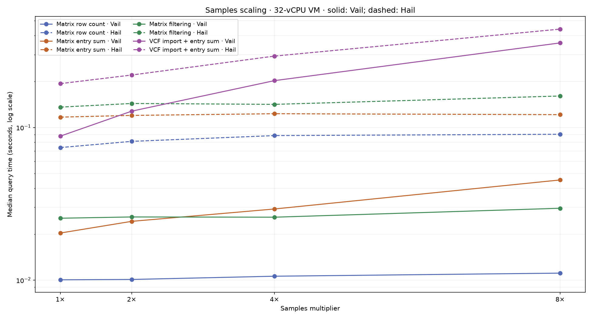
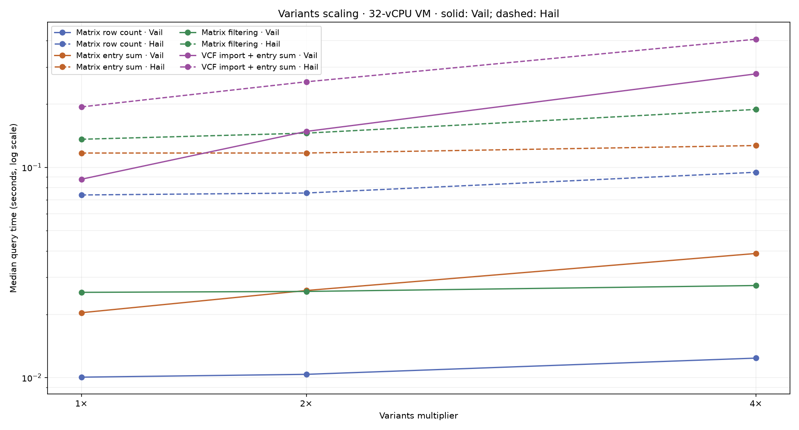
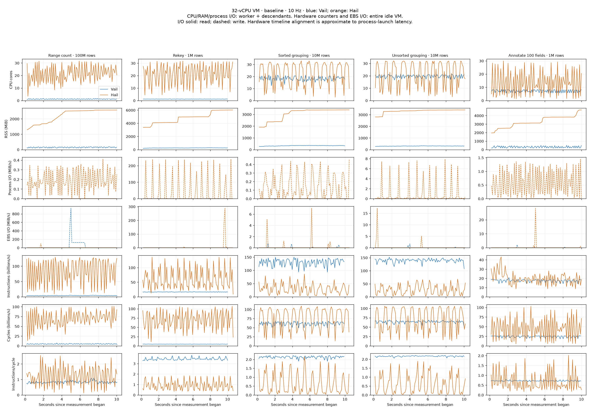
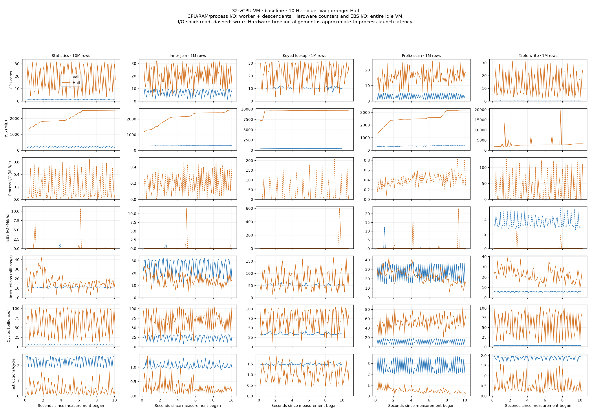
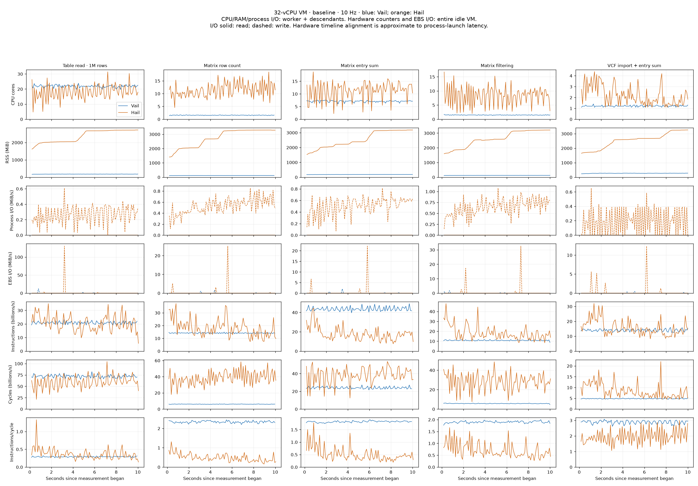
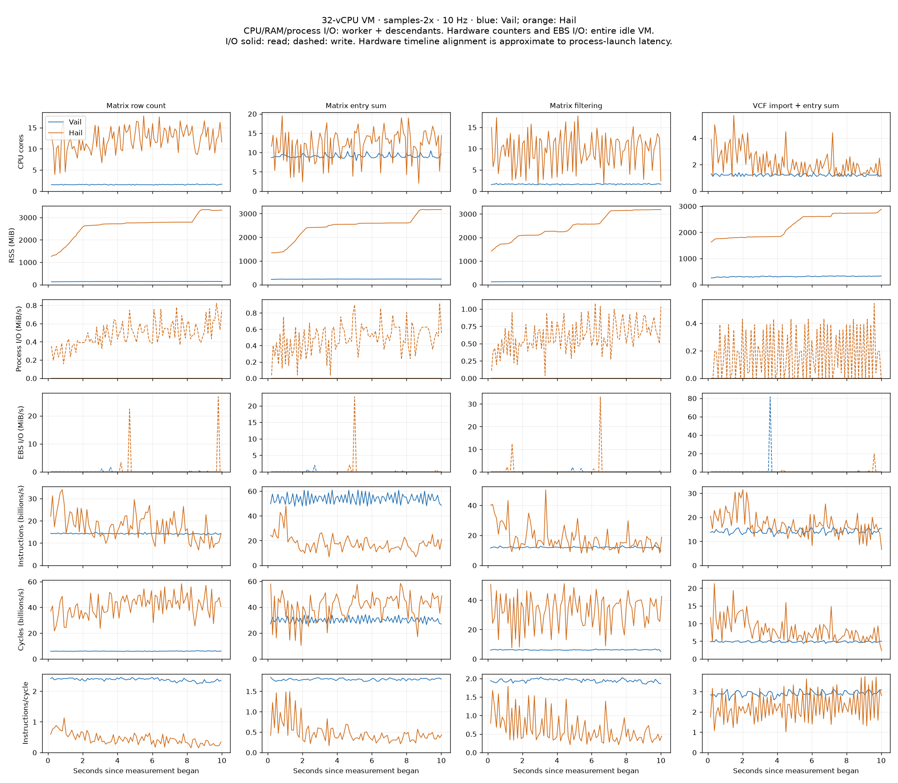
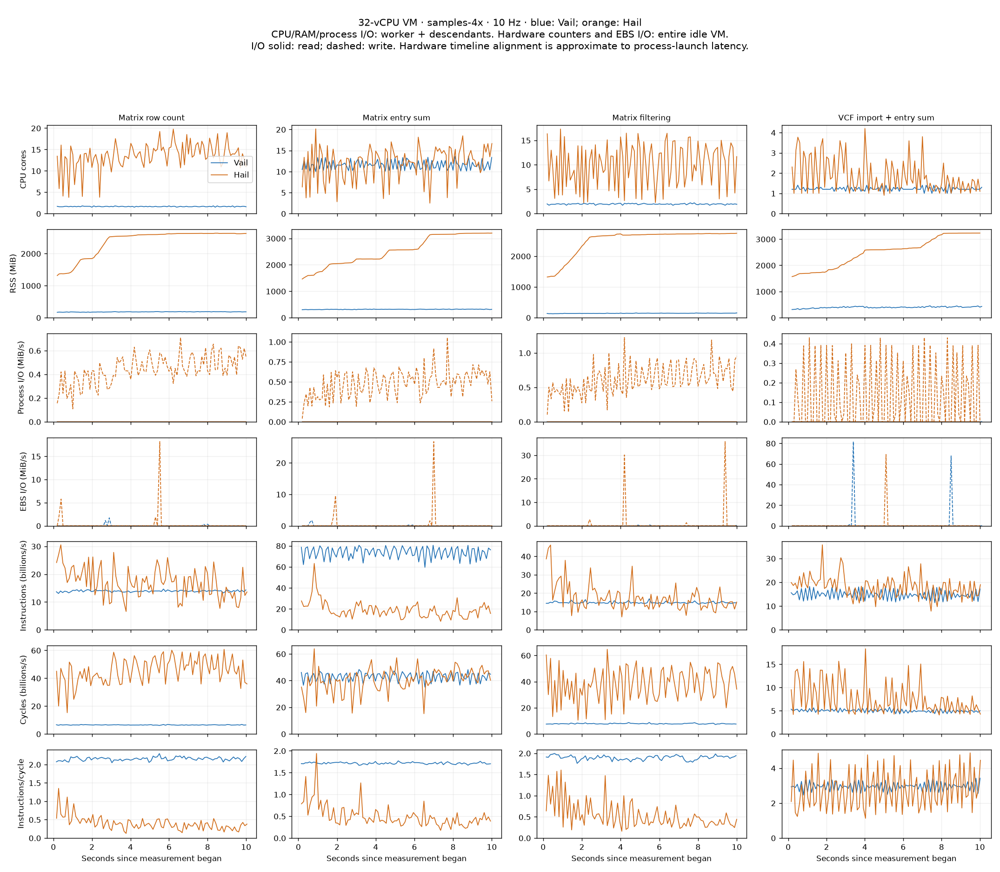
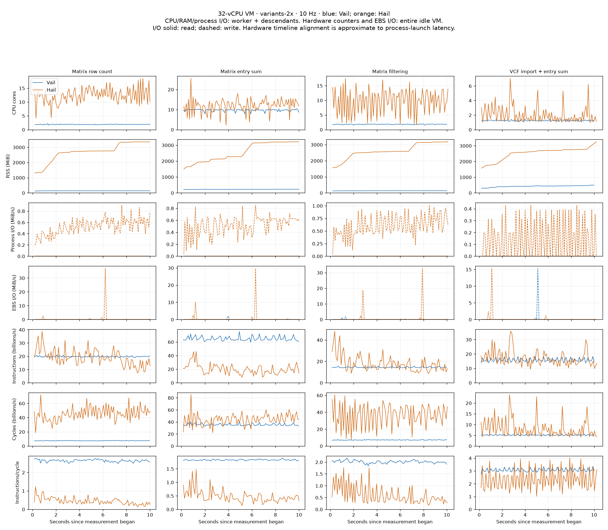
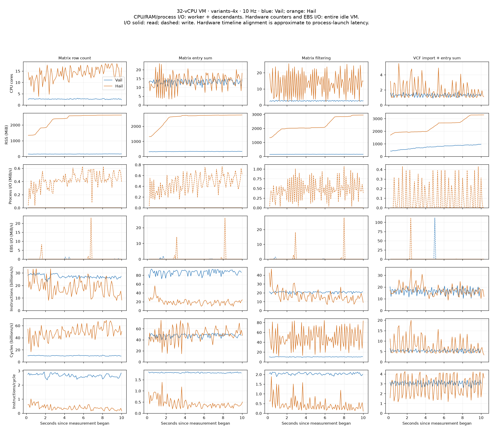
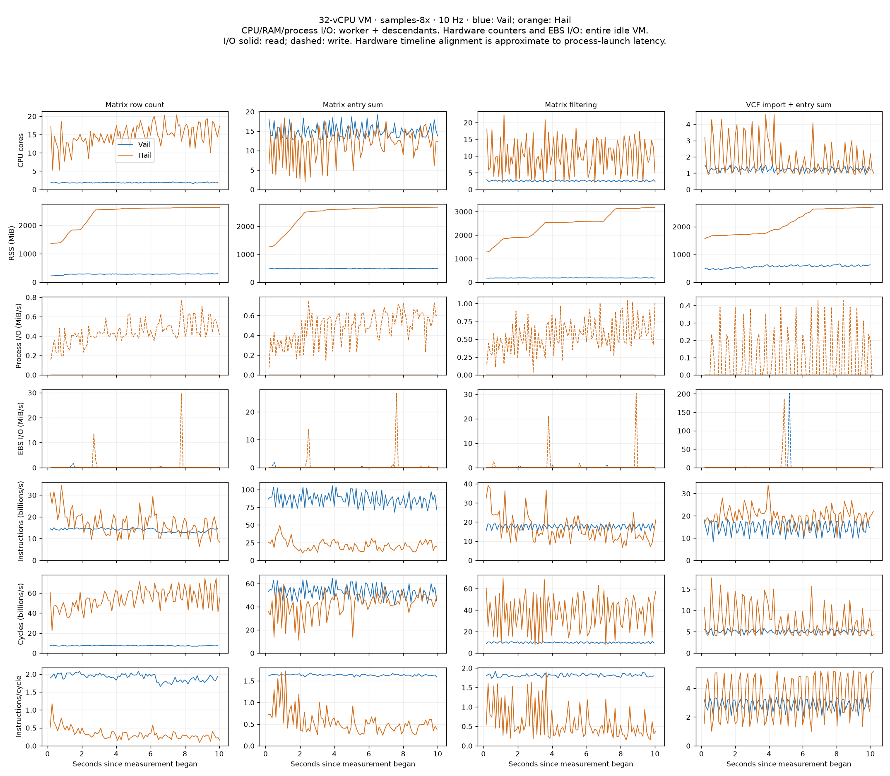

# Cloud Hail/Vail benchmarks

AWS m7i.8xlarge, Ubuntu 22.04, 32 vCPUs (16 cores × 2 SMT threads), 128 GiB RAM, 200 GiB gp3 EBS. Both engines use Python 3.11.17. Synthetic sources request 32 partitions; Vail has 32 runtime workers and Hail uses Spark local[32] with a 64 GiB heap. Stock Hail is installed from PyPI; Vail is built with --release --locked and target-cpu=native, using Rust 1.98.0.

All runs execute serially on the otherwise idle VM after compilation. Each has three warmups and at least ten measured seconds of fresh lazy queries. Result-bearing workloads assert their results every iteration; writing is also exercised by the separately checked read workload. Totals sum per-case medians (one invocation of each case), excluding startup/warmups. Raw iterations, 10 Hz traces, perf output, script hashes, configuration, and elapsed wall time are retained.

## Complete 15-case baseline

| Benchmark | Vail (s) | Hail (s) | Hail/Vail |
|---|---:|---:|---:|
| Range count · 100M rows | 0.255713 | 0.170742 | 0.67× |
| Rekey · 1M rows | 0.124797 | 0.693918 | 5.56× |
| Sorted grouping · 10M rows | 0.027723 | 0.870252 | 31.39× |
| Unsorted grouping · 10M rows | 0.026760 | 0.872332 | 32.60× |
| Annotate 100 fields · 1M rows | 0.038769 | 0.246818 | 6.37× |
| Statistics · 10M rows | 0.311928 | 0.387772 | 1.24× |
| Inner join · 1M rows | 0.144668 | 0.236152 | 1.63× |
| Keyed lookup · 1M rows | 0.098370 | 1.554489 | 15.80× |
| Prefix scan · 1M rows | 0.206202 | 0.175153 | 0.85× |
| Table write · 1M rows | 0.406323 | 0.352681 | 0.87× |
| Table read · 1M rows | 0.018483 | 0.141670 | 7.67× |
| Matrix row count | 0.010051 | 0.073876 | 7.35× |
| Matrix entry sum | 0.020353 | 0.116910 | 5.74× |
| Matrix filtering | 0.025440 | 0.135951 | 5.34× |
| VCF import + entry sum | 0.087763 | 0.193759 | 2.21× |
| **Total** | **1.803343** | **6.222475** | **3.45×** |

Summing all 35 distinct workload configurations (the baseline is counted once): Vail **3.271323 s**, Hail **9.657717 s**.

## Scaling totals

The four Matrix/VCF cases have sample/variant dimensions. 1× is 10 samples, 100,000 Matrix rows and 50,000 VCF variants; one dimension changes at a time. The two series share their 1× baseline. Table-only workloads are measured in the full baseline above.

| Dimension | Scale | Vail total (s) | Hail total (s) | Hail/Vail |
|---|---:|---:|---:|---:|
| samples | 1× | 0.143607 | 0.520496 | 3.62× |
| samples | 2× | 0.188280 | 0.565373 | 3.00× |
| samples | 4× | 0.268459 | 0.646892 | 2.41× |
| samples | 8× | 0.444121 | 0.813512 | 1.83× |
| variants | 1× | 0.143607 | 0.520496 | 3.62× |
| variants | 2× | 0.210180 | 0.592841 | 2.82× |
| variants | 4× | 0.356941 | 0.816623 | 2.29× |

## Samples medians

| Benchmark | Vail 1× | Hail 1× | Vail 2× | Hail 2× | Vail 4× | Hail 4× | Vail 8× | Hail 8× |
|---|---:|---:|---:|---:|---:|---:|---:|---:|
| Matrix row count | 0.010051 | 0.073876 | 0.010103 | 0.081119 | 0.010609 | 0.088501 | 0.011116 | 0.090292 |
| Matrix entry sum | 0.020353 | 0.116910 | 0.024277 | 0.119973 | 0.029251 | 0.123070 | 0.045324 | 0.121365 |
| Matrix filtering | 0.025440 | 0.135951 | 0.025941 | 0.143626 | 0.025845 | 0.141723 | 0.029569 | 0.160776 |
| VCF import + entry sum | 0.087763 | 0.193759 | 0.127959 | 0.220656 | 0.202754 | 0.293599 | 0.358112 | 0.441078 |

## Variants medians

| Benchmark | Vail 1× | Hail 1× | Vail 2× | Hail 2× | Vail 4× | Hail 4× |
|---|---:|---:|---:|---:|---:|---:|
| Matrix row count | 0.010051 | 0.073876 | 0.010367 | 0.075472 | 0.012383 | 0.094728 |
| Matrix entry sum | 0.020353 | 0.116910 | 0.025960 | 0.116946 | 0.038942 | 0.126917 |
| Matrix filtering | 0.025440 | 0.135951 | 0.025691 | 0.145360 | 0.027412 | 0.188469 |
| VCF import + entry sum | 0.087763 | 0.193759 | 0.148162 | 0.255063 | 0.278204 | 0.406509 |

## Telemetry

CPU/RAM/process I/O include the worker and its descendants, including the Hail JVM. RSS may double-count shared pages. Hardware counters include the entire guest and the monitor; EBS rates are for the VM's virtual block device, not physical SSD hardware. Only full intervals within measurement contribute to plots and summaries. Hardware interval alignment includes small process-launch latency.

The local attempt was discarded after unrelated compilation caused CPU contention. The cloud write capture was retried after the monitor encountered a procfs permission race on a short-lived helper. Completed captures were retained; failed captures do not contribute to totals. Subsequent captures record unreadable descendant PIDs explicitly in summary.json. The primary worker is never silently skipped. Process-tree snapshots can miss short-lived helpers, so Hail write's process CPU/RSS/I/O measurements are approximate; the guest-wide hardware counters include those helpers.

The virtual PMU reported zero cache misses in every capture. Do not interpret that as evidence of no cache misses; the raw counts are retained, but this counter is not used for performance conclusions.

