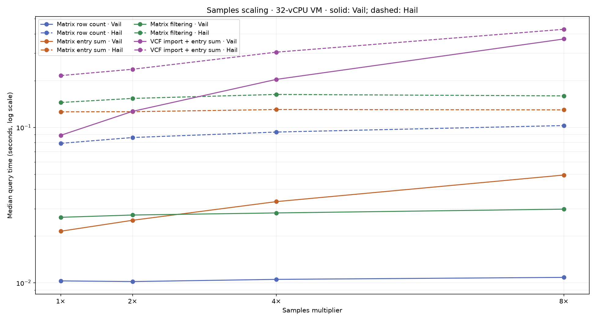
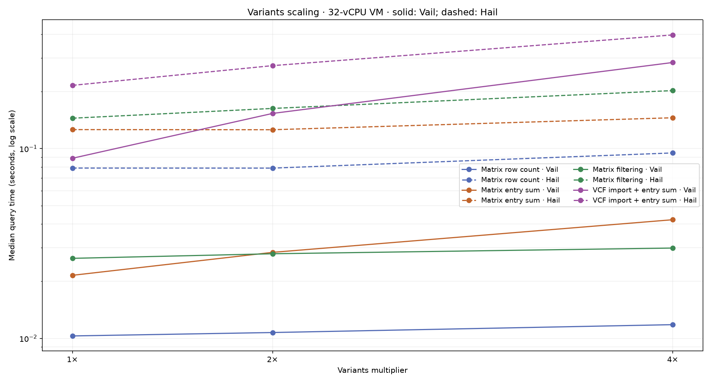
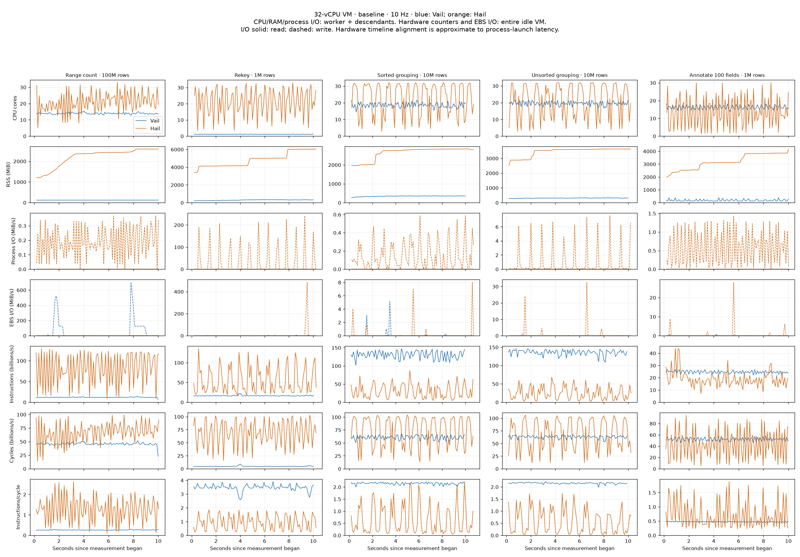
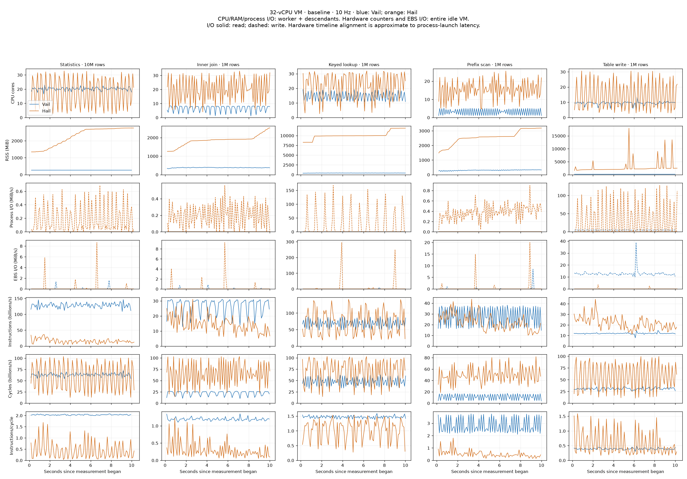
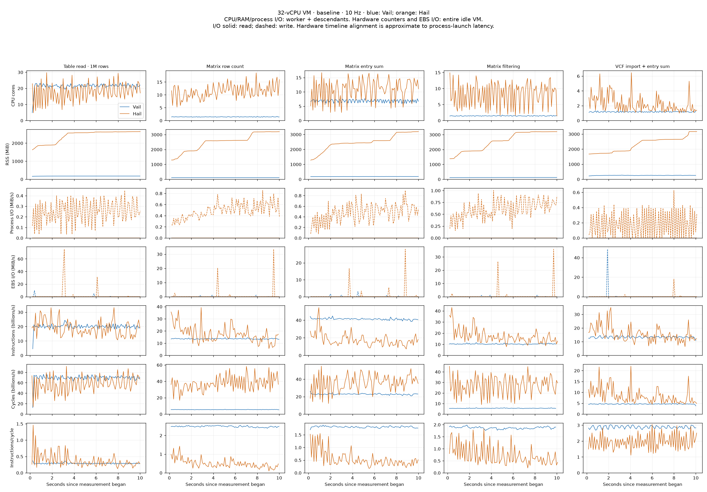
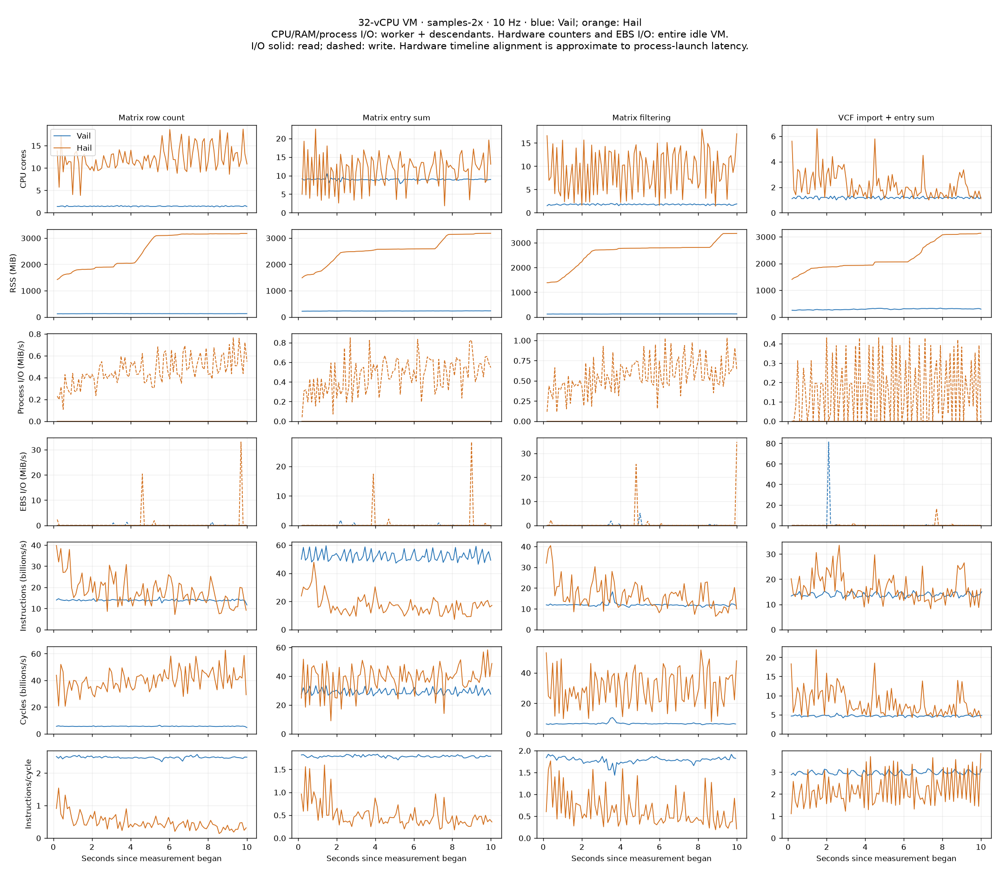
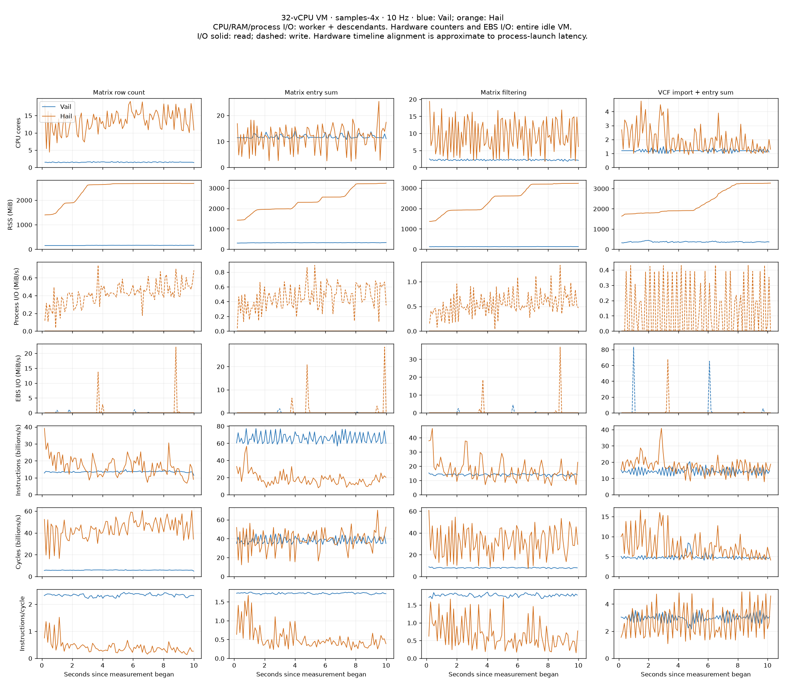
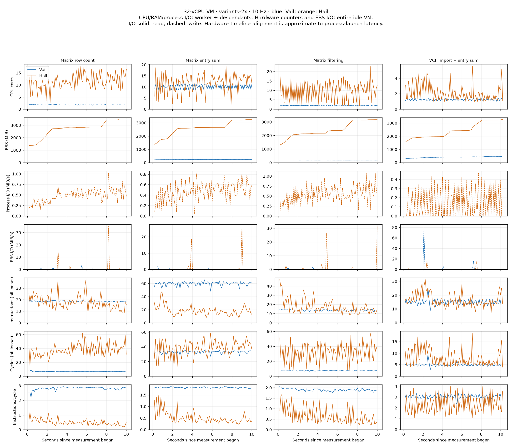
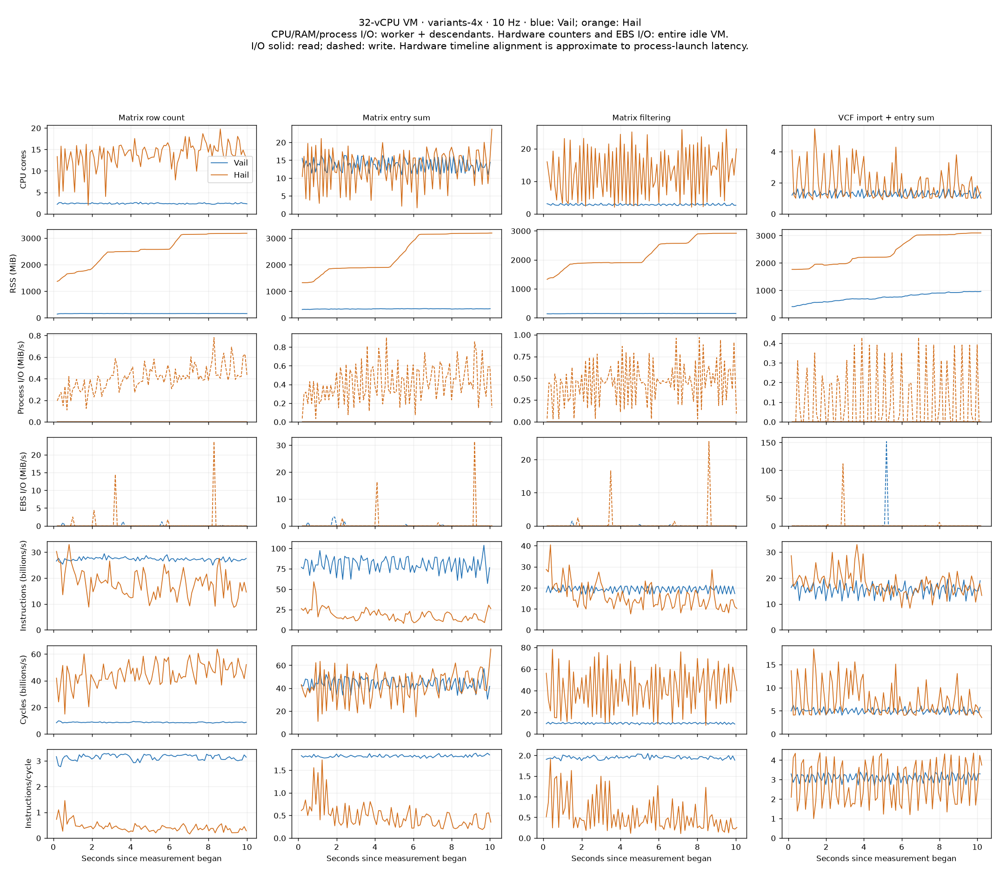
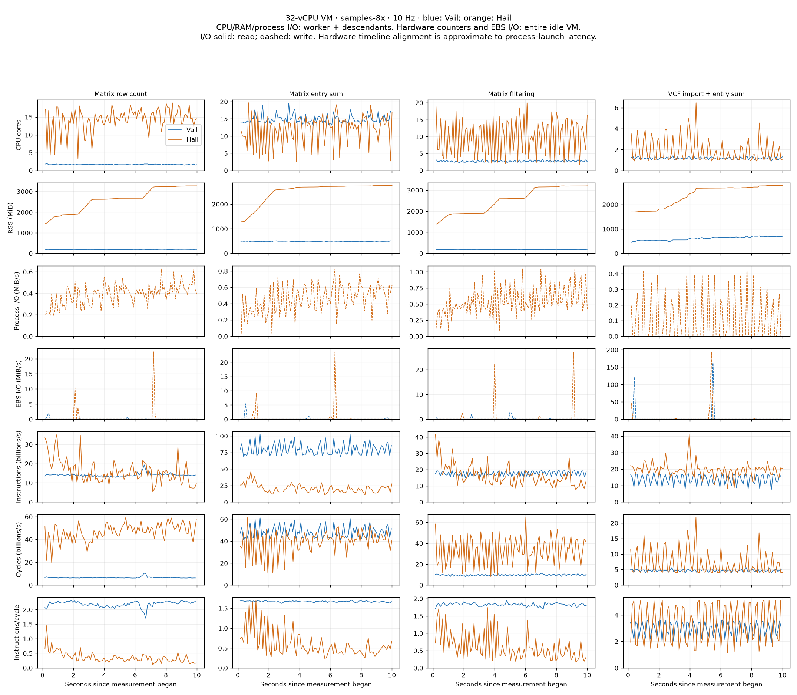

# Cloud Hail/Vail benchmarks

AWS m7i.8xlarge, Ubuntu 22.04, 32 vCPUs (16 cores × 2 SMT threads), 128 GiB RAM, 200 GiB gp3 EBS. Both engines use Python 3.11.17. Synthetic sources request 32 partitions; Vail has 32 runtime workers and Hail uses Spark local[32] with a 64 GiB heap. Stock Hail is installed from PyPI; Vail is built with --release --locked and target-cpu=native, using Rust 1.98.0.

All runs execute serially on the otherwise idle VM after compilation. Each has three warmups and at least ten measured seconds of fresh lazy queries. Result-bearing workloads assert their results every iteration; writing is also exercised by the separately checked read workload. Totals sum per-case medians (one invocation of each case), excluding startup/warmups. Raw iterations, 10 Hz traces, perf output, script hashes, configuration, and elapsed wall time are retained.

## Complete 15-case baseline

| Benchmark | Vail (s) | Hail (s) | Hail/Vail |
|---|---:|---:|---:|
| Range count · 100M rows | 0.008116 | 0.176929 | 21.80× |
| Rekey · 1M rows | 0.127031 | 0.779458 | 6.14× |
| Sorted grouping · 10M rows | 0.028487 | 0.825604 | 28.98× |
| Unsorted grouping · 10M rows | 0.027596 | 0.947391 | 34.33× |
| Annotate 100 fields · 1M rows | 0.030139 | 0.246393 | 8.18× |
| Statistics · 10M rows | 0.023404 | 0.406284 | 17.36× |
| Inner join · 1M rows | 0.125680 | 0.250826 | 2.00× |
| Keyed lookup · 1M rows | 0.073483 | 1.671971 | 22.75× |
| Prefix scan · 1M rows | 0.196664 | 0.187975 | 0.96× |
| Table write · 1M rows | 0.051829 | 0.353876 | 6.83× |
| Table read · 1M rows | 0.018906 | 0.149129 | 7.89× |
| Matrix row count | 0.010297 | 0.078970 | 7.67× |
| Matrix entry sum | 0.021491 | 0.125945 | 5.86× |
| Matrix filtering | 0.026407 | 0.144646 | 5.48× |
| VCF import + entry sum | 0.088962 | 0.215479 | 2.42× |
| **Total** | **0.858492** | **6.560877** | **7.64×** |

Summing all 35 distinct workload configurations (the baseline is counted once): Vail **2.373127 s**, Hail **10.156054 s**.

## Scaling totals

The four Matrix/VCF cases have sample/variant dimensions. 1× is 10 samples, 100,000 Matrix rows and 50,000 VCF variants; one dimension changes at a time. The two series share their 1× baseline. Table-only workloads are measured in the full baseline above.

| Dimension | Scale | Vail total (s) | Hail total (s) | Hail/Vail |
|---|---:|---:|---:|---:|
| samples | 1× | 0.147157 | 0.565039 | 3.84× |
| samples | 2× | 0.189680 | 0.602647 | 3.18× |
| samples | 4× | 0.275715 | 0.691528 | 2.51× |
| samples | 8× | 0.460598 | 0.819793 | 1.78× |
| variants | 1× | 0.147157 | 0.565039 | 3.84× |
| variants | 2× | 0.220315 | 0.641293 | 2.91× |
| variants | 4× | 0.368327 | 0.839916 | 2.28× |

## Samples medians

| Benchmark | Vail 1× | Hail 1× | Vail 2× | Hail 2× | Vail 4× | Hail 4× | Vail 8× | Hail 8× |
|---|---:|---:|---:|---:|---:|---:|---:|---:|
| Matrix row count | 0.010297 | 0.078970 | 0.010194 | 0.086101 | 0.010531 | 0.093358 | 0.010845 | 0.102773 |
| Matrix entry sum | 0.021491 | 0.125945 | 0.025271 | 0.126218 | 0.033317 | 0.130293 | 0.049395 | 0.129690 |
| Matrix filtering | 0.026407 | 0.144646 | 0.027315 | 0.153684 | 0.028172 | 0.162960 | 0.029799 | 0.159502 |
| VCF import + entry sum | 0.088962 | 0.215479 | 0.126899 | 0.236644 | 0.203695 | 0.304916 | 0.370559 | 0.427828 |

## Variants medians

| Benchmark | Vail 1× | Hail 1× | Vail 2× | Hail 2× | Vail 4× | Hail 4× |
|---|---:|---:|---:|---:|---:|---:|
| Matrix row count | 0.010297 | 0.078970 | 0.010733 | 0.078915 | 0.011807 | 0.094891 |
| Matrix entry sum | 0.021491 | 0.125945 | 0.028394 | 0.125758 | 0.042197 | 0.145415 |
| Matrix filtering | 0.026407 | 0.144646 | 0.027913 | 0.162859 | 0.029919 | 0.202259 |
| VCF import + entry sum | 0.088962 | 0.215479 | 0.153276 | 0.273761 | 0.284404 | 0.397351 |

## Telemetry

CPU/RAM/process I/O include the worker and its descendants, including the Hail JVM. RSS may double-count shared pages. Hardware counters include the entire guest and the monitor; EBS rates are for the VM's virtual block device, not physical SSD hardware. Only full intervals within measurement contribute to plots and summaries. Hardware interval alignment includes small process-launch latency.

The local attempt was discarded after unrelated compilation caused CPU contention. The cloud write capture was retried after the monitor encountered a procfs permission race on a short-lived helper. Completed captures were retained; failed captures do not contribute to totals. Subsequent captures record unreadable descendant PIDs explicitly in summary.json. The primary worker is never silently skipped. Process-tree snapshots can miss short-lived helpers, so Hail write's process CPU/RSS/I/O measurements are approximate; the guest-wide hardware counters include those helpers.

The virtual PMU reported zero cache misses in every capture. Do not interpret that as evidence of no cache misses; the raw counts are retained, but this counter is not used for performance conclusions.

