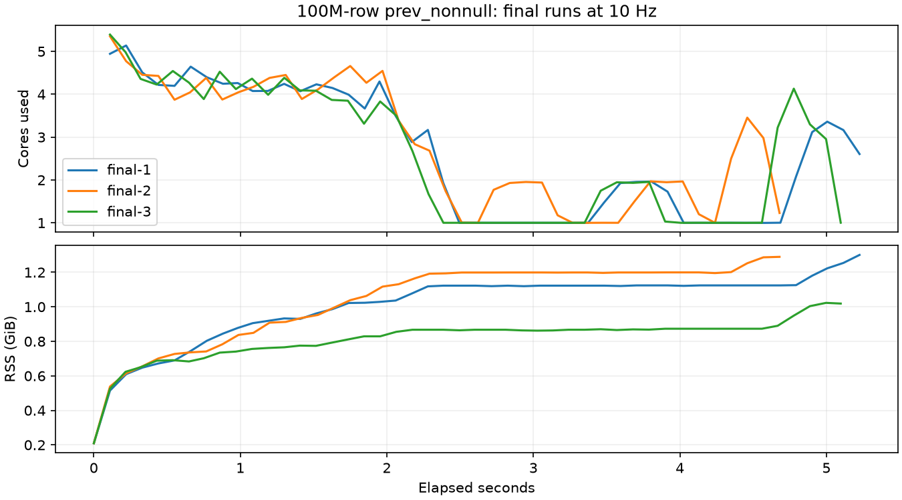

# Streaming previous-defined scan: 100 million rows

`benchmark_table::test_table_scan_prev_non_null` returns all **100,000,000 rows** in a median **5.13s elapsed / 5.11s count action** across three fresh processes. The previously recorded DataFusion window implementation took **31.87s elapsed / 31.85s action** on this laptop: the new observed runtime is about **6.2× faster** than that historical measurement. This is not an isolated same-revision causal comparison: the historical package and current main differ beyond this patch.

| Run | Elapsed seconds | Count action seconds | CPU seconds | Peak RSS GiB |
|---|---:|---:|---:|---:|
| Historical window package | 31.87 | 31.85 | unavailable | unavailable |
| Final 1 | 4.916 | 4.895 | 13.251 | 1.168 |
| Final 2 | 5.134 | 5.113 | 13.272 | 1.198 |
| Final 3 | 5.222 | 5.201 | 13.001 | 1.253 |
| Final, separately profiled | 4.747 | 4.723 | 12.426 | 1.164 |

The historical GCP Hail measurement is **3.927s / 24.32 CPU-seconds / 1.041GiB** on a 32-vCPU n2-standard-32. That is a different host, not a paired comparison with these laptop runs. Hail was not rerun.

The fresh pre-change main package, with only the Python compatibility helper restored, did **not** finish its 35s bounded profile. It used the generic fold/window path and reached 11.63GiB sampled RSS. It is a bounded hotspot sample, not a completed runtime or a direct speedup denominator. Construction is lazy in every case.



## Query and implementation

The harness extracts and executes the original upstream function AST without rewriting the workload:

```python
ht = hl.utils.range_table(100000000, n_partitions=10)
ht = ht.annotate(x=hl.range(0, ht.idx % 25))
ht = ht.annotate(y=hl.scan._prev_nonnull(ht.row))
ht._force_count()
```

The public `hl.scan.prev_nonnull` method composes the existing public `scan.fold`; the private Hail spelling is an alias. A strict matcher recognizes only the null-identity, last-defined-value fold. It rejects state-dependent sequence values, aliased state binders, non-null initializers, randomness and incompatible scoped aggregates.

DataFusion plans all input expressions. The logical streaming extension emits whole Arrow batches: concatenation for null-free values, interleaving indices for nullable values. It retains one compact Arrow value across batches, never a per-row `ScalarValue`/one-row `RecordBatch`. Carry summaries replay the same optimized physical producer with fresh execution state, preserving its partition domain. Each output depends only on predecessor partitions; cached predecessor carries/summaries perform O(partitions) shared work. Summary concurrency is bounded at 32, with abort-on-drop tasks and fresh retry producer state after cancellation. Explicit physical reset clears action caches. The specialized path adds no sort, join or window.

For correctness, specialization currently covers deterministic pointwise maps/filters over independently executable native reads, Arrow parallelize and range sources (including removing keys without sorting). Mixed reducers, aggregate filters/nested scopes, randomness and upstream sorts/joins/exchanges/scans keep the general implementation. This capability boundary avoids assuming that an exchange can produce one output without consuming others. It does not alter results; broader streaming coverage remains future work.

## Profile findings

The fresh bounded baseline shows `FoldAccumulator::update_batch` and repeated column/CASE evaluation, allocation/free traffic and DataFusion window/sort frames. The final sample no longer contains these scan window/sort paths. Its remaining work is predominantly DataFusion list-range construction, widening/narrowing casts and bulk Arrow memory operations. The benchmark constructs approximately 1.2 billion array elements per pass; partition summary replay still evaluates those row expressions. This patch does not claim to remove that work, eliminate all allocation, or make this faster than Hail on the same hardware.

Hotspot summaries are committed. Samply profiles and resolved symbol sidecars remain locally under `/Users/danielking/projects/vail/vail/conformance/runs/20261016-streaming-prev-nonnull/` (`before-profile.json.gz`, `final-profile.json.gz` and `.json.syms.json` files); they are not build inputs and are excluded from this evidence commit.

## Validation and provenance

- **81 Python tests pass:** new public previous-defined cases plus the existing scan, stream aggregate scan and arbitrary fold suites. Covers nested structs/arrays, missing and all-missing values, empty structs/partitions, long missing runs across batches, key-order fallback, non-null fold identity, state-dependent noncanonical fold, repeated actions, current-row finishing expressions, 1,100 partitions and public `head` demand before future bad casts.
- **2 native public integration tests pass:** TableIR/prepared-action execution after timed reader cancellation, late then earlier output partition demand, fresh action reset; nested `StringViewArray` backed by a 16MiB value returns canonical UTF8 prefix storage with less than 16KiB attached buffers. The timed cancellation test does not assert that initialization was interrupted on every scheduler run; it asserts correct observable retry results whether the first request completed or was interrupted. The output buffer test proves observable canonical compactness; carry retention is additionally supported by the inspected canonicalization/ownership code.
- No mocks, per-row data serialization or private operator counters. Data remains Arrow. JSON summaries are metrics/control metadata.
- Production source: `761c9f71fbf894e1cc289751da33b95f7094520f`, based on main `0cbeba43bb3f822f16044a3ee3f4f1acc44ed267`. Final native SHA256 `4b4a19898a29a228e45fb1890512d95422fe67a768856c1e25ea05d2520801f0`.
- Exact upstream source SHA256 `a5e0c64d261d174743551150d6952abcb18fa615abe86950f673cb32d1d3b22d`.
- Fresh baseline native SHA256 `7ecb7cfbac3eb783db21991097c4dffa0bc89b471d143f77517a17da717d4394`, the prior main build, plus Python-only canonical helper. Historical window native SHA256 `63e0bde72dcebf2afa91da75857aa06b6a8861109aaa7e7cb1f728f63ff10158`; its runner reported source revision a965c01 plus the then-uncommitted window recognition fix, so the native hash/package is its precise identity. Historical summary included verbatim.
- Apple M3 Max, 14 logical/physical cores, 96GiB RAM. Fresh processes; no overlapping builds or benchmarks during timing. Process CPU/RSS sampled at 10Hz. Separate Samply profile at 500Hz; its timing is not included in the three-run median.
- Native build resolves the identical main DataFusion-common patch via `/Users/danielking/.codex/worktrees/1611/vail/vail/patches/datafusion-common` for cache reuse. Integration tests use the native compiler flags, 11.0 deployment target and PyO3 configuration to avoid a duplicate dependency variant.

## Reproduce

From the Vail project directory after building/installing the candidate:

```sh
.venv/bin/python benchmarks/profile_prev_nonnull.py \
  --package "$PWD/python" \
  --upstream ../hail/hail/python/benchmark/hail/benchmark_table.py \
  --output /private/tmp/prev-results --max-seconds 120 --max-rss-gib 8

PYTHONPATH="$PWD/python" .venv/bin/python -m pytest -q \
  -o "pythonpath=$PWD/python" python/tests/test_streaming_prev_nonnull.py \
  python/tests/test_scan.py python/tests/test_stream_aggregate_scan.py \
  python/tests/test_agg_fold.py

cargo test --release -p vail-python -p vail-table \
  --features pyo3/extension-module --test streaming_prev -- --nocapture
```

For a profile, prefix the benchmark command with `samply record --rate 500 --save-only --unstable-presymbolicate -o /private/tmp/prev-profile.json.gz`.
