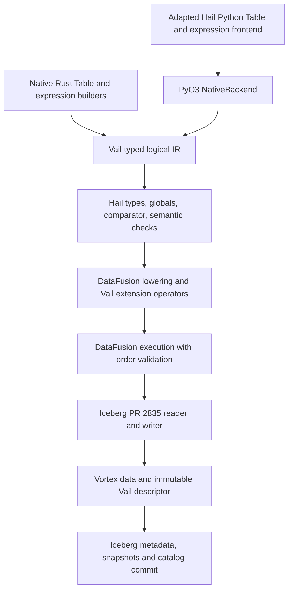

# Vail implementation plan

Status: source-grounded design, 2026-09-24; first implementation wave has started. See [the README for the implemented subset](../README.md), [the exact upstream revisions](../upstreams.lock.json), and [assigned work packages](TASKS.md). The gates below remain the target, not a claim that all their acceptance criteria are complete.

## Recommendation

Build a Hail semantic layer over DataFusion, reuse an adapted Hail Python frontend, and expose the same native logical plan through an embeddable Rust API. Use Vortex for data files and Iceberg for snapshot/catalog machinery through [apache/iceberg-rust PR #2835](https://github.com/apache/iceberg-rust/pull/2835), pinned to `0252fe9174aa3062da51328c444a765aa7de2dae`. Reuse its Vortex writer, reader, field-ID handling and scan dispatch. Keep Vail's snapshot descriptor protocol separate from the upstream file-format integration.

**Storage reads must not sort the entire table.** For persisted keyed tables, plan fragments in lexicographic key-interval order using an immutable index bound to the Iceberg snapshot. Establish and validate sorted fragments when writing. Missing or invalid required ordering metadata fails the read and requires an explicit repair/import step; it never triggers a hidden full-table sort.

Ordering is feasible, but cannot be delegated entirely to either DataFusion or Iceberg. DataFusion supplies local ordering analysis, sorting, and ordered merging; Vail must own the Hail comparator, logical row-order requirements, ordered partition traversal, and ordered storage scans. Iceberg sort metadata alone is insufficient evidence of globally ordered rows.

The Table surface also includes globals, nested/genomic types, expression scoping, missingness, aggregations, scans, and reference data. These are substantive compatibility work beyond a DataFusion DataFrame wrapper.

## Target and scope

- A Rust library usable in-process, without a JVM, Spark, Python interpreter, mandatory catalog server, or separate execution service.
- A lazy Python Table/GroupedTable and expression API matching the pinned Hail baseline operation for operation. Shared Rust semantics serve both entrypoints.
- Matching public schemas, types, values, missingness, keys, observable ordering, globals, validation, and return objects. Physical execution strategy may change; public behavior may not silently change.
- A Vortex-backed snapshot format replaces native Hail `.ht` storage. Preserve Table `write`, `read_table`, and `checkpoint` behavior, including globals, references, overwrite handling, and order; file bytes/layout intentionally differ.
- Reading legacy `.ht` bytes and migration tooling are deferred by user direction. Current storage work and conformance fixtures target the new Vortex/Iceberg format only.
- First delivery targets embedded execution, including bounded-memory spill. A distributed scheduler and MatrixTable computation are outside this engine milestone. Logical partition APIs remain in the Table compatibility contract and cannot be mapped casually to worker threads.
- Table methods crossing into MatrixTable, Spark, pandas, and external formats stay in the inventory. pandas and Table import/export adapters are implementation work. MatrixTable-producing methods and the exact Spark compatibility boundary require a recorded scope decision or working adapters before advertising unrestricted Table API parity. They must not disappear from the checklist.

The baseline is a pinned Hail commit, not a moving promise to match every future release. Intermediate slices are deliberately partial; version 1 is complete only when every in-scope inventory entry and its transitive expression/aggregator dependencies pass conformance. Private experimental methods are tracked separately unless required by public methods.

## What the upstream audit establishes

| Area | Available | Vail responsibility |
| --- | --- | --- |
| Hail order | Key order; explicit `order_by`; tie order generally unspecified | Encode exact observable requirements per operation and comparator |
| DataFusion | Ordering properties, range metadata/routing, input requirements, sort enforcement, sorted merge, custom operators | Hail semantics and proof of global/range order across partitions |
| Vortex | Native files, Arrow conversion, DataFusion integration | Ordered file/split scheduling and verified property advertisement |
| Iceberg | Snapshots, catalogs, field IDs, per-file sort IDs | Snapshot-bound Hail metadata and ordered runs; integration of PR #2835 |

Evidence is detailed in [Hail](research/hail-table-contract.md), [DataFusion](research/datafusion-ordering.md), and [storage](research/vortex-iceberg-storage.md) audit notes. In particular, the checked-out [Iceberg spec](https://github.com/apache/iceberg/blob/5e7169168db3d34e29354c6f59ec4d6e420b8d2d/format/spec.md#L638) describes per-file sorting and allows writers to omit default sorting. Its [file-format list](https://github.com/apache/iceberg/blob/5e7169168db3d34e29354c6f59ec4d6e420b8d2d/format/spec.md#L721), Java `FileFormat`, and Rust `DataFileFormat` at the original audit revisions have no Vortex data-file support. PR #2835 supplies the Rust integration and supersedes the original proposal to implement it ourselves. Its reader and writer are the implementation baseline; the original main-branch audit remains useful for the specification and ordering limits. The open PR does not establish compatibility with all Iceberg engines.

## Architecture

Proposed modules, to become crates only as they gain real implementation:

| Module | Owns |
| --- | --- |
| `vail-core` | Types, typed logical IR, table metadata, source identity, comparator contract |
| `vail-expr` | Hail scalar/aggregate/scan semantics, reference genomes, function registry |
| `vail-execution` | DataFusion lowering, property validation, custom scans/prefix operators |
| `vail-storage` | PR #2835 integration, Hail field mapping, order enforcement, snapshot descriptors and commits |
| `vail` | Public Rust session/Table API, resource limits, cancellation, errors |
| `vail-python` | PyO3 bridge; adapted Python frontend lives under `python/` |
| `conformance/` | Hail oracle runner, typed fixtures, signature and behavior coverage |

Use DataFusion's extension points before considering a fork. Pin the upstream Iceberg PR and isolate any Vail-specific snapshot hooks as a separate patch. Do not duplicate its Vortex reader/writer or catalog/transaction implementation. The Python extraction choice and its backend/import obstacles are documented [separately](research/python-frontend.md).

A native session owns its memory pool, spill directory, object stores, catalog access, function/reference registry, and cancellation. Accept an existing async runtime and offer an explicit blocking facade; avoid hidden nested Tokio runtimes. Python releases the GIL for execution and carries errors/cancellation across the boundary. Use Arrow batches/C Stream at data boundaries where compatible; zero-copy is conditional on layout and decoding, not a blanket promise.

## Ordering contract

### Separate logical requirements from physical facts

Each logical Table carries row/global types, key field identities, logical partition information where observable, and a row-order requirement. Keys identify ordering and lookup fields; they do not establish uniqueness.

Requirements come from the actual operation contract, not merely the presence of a declared key. Hail's internal/prefix `TableJoin` path (exposed through private `_join_key`) explicitly warns of out-of-key-order results for certain duplicate/prefix combinations. Track that exception in the IR coverage and oracle suite; do not silently turn an implementation caveat into a stronger public guarantee or apply unsafe downstream optimizations to it. The ordinary full-key join contract remains separate.

Model physical facts separately:

1. **Unknown/unordered**: no ordering proof.
2. **Locally sorted partitions**: every stream is sorted using a specified comparator; the streams may overlap.
3. **Ordered ranges**: each stream is sorted, partition traversal order is explicit, and adjacent bounds satisfy the comparator. Equal-key overlap may be allowed but must be represented; algorithms requiring complete key groups need a stronger property or a boundary merge.
4. **One ordered stream**: a globally sorted stream or an explicitly required sequence delivered serially.

Retain the exact sort expressions/directions, null policy, logical type/comparator version, key-prefix relationships, and the evidence for each property. An expression fingerprint or lineage ID is required when expressions are not materialized fields. Store key uniqueness only when proved, independently of sortedness.

These facts supplement DataFusion `PlanProperties`/`EquivalenceProperties`; an ordering on each output partition is not automatically a global ordering. A Vail invariant validator runs after physical optimization and at order-sensitive sinks. Custom operators must correctly declare input requirements and output properties; a late validator alone cannot undo an already incorrect optimizer rewrite.

### Operation rules

| Operation | Required treatment |
| --- | --- |
| `key_by` | Materialize key expressions; enforce ascending Hail lexicographic key order; prefix reuse only with a valid comparator/projection proof |
| `order_by` | Preserve explicit multi-column sort and Hail missing-value policy; remove the key without discarding the explicit row-order requirement |
| Projection/annotation/rename | Preserve order through unchanged sort expressions and field identities; remap aliases; retain hidden sort expressions only internally if necessary |
| Filter | Preserve surviving-row order; update or discard counts/bounds; Hail missing predicates require exact semantics |
| `key_by()` | Remove the key requirement; do not invent a new stable insertion-order promise |
| Join/index/semi/anti | Match Hail null and duplicate rules first; restore required output key order when the physical join destroys it |
| Union | Preserve duplicates; reconcile schemas/globals exactly; merge sorted runs or re-sort keyed output rather than blindly concatenate |
| Group/aggregate/distinct | Match grouping/equality/missingness and output key; sort output when required; never treat key as unique by declaration |
| `collect`, `take`, `head`, `tail`, display/export | Consume the Table's effective order before applying truncation; reverse traversal for tail is valid only with a proof |
| `add_index`, `hl.scan.*` | Traverse the effective logical sequence, including partition boundaries; use prefix offsets/state, not task completion order |
| Repartition/coalesce/persist | Re-prove properties; preserve observable partition contracts; physical thread count is separate |
| Read a persisted ordered table | Use snapshot-bound key-interval fragment planning; validate ordering metadata and preserve it through scan scheduling; never insert a whole-table sort |
| Explode/sample/random expressions | Preserve only Hail's guaranteed behavior; verify missing/empty, multiplicity, seed, and partition dependence against Hail |

Hail explicitly leaves equal-key row order undefined and ordinarily leaves unkeyed order undefined. Do not enforce a permanent synthetic row ID everywhere. Use internal sequence tokens only where an actual operation requires sequence preservation, and keep their semantics distinct from Iceberg v3 lineage IDs. Explicit `order_by` is an exception to an otherwise unkeyed Table being unordered. Test tie behavior relationally, rather than copying one incidental Hail execution trace.

### Execution strategy

For operations that establish or change order, such as `key_by` on unordered input or an order-destroying join, use per-partition external sort plus `SortPreservingMergeExec` as needed. A persisted keyed read starts with an ordered fragment scan; it must not feed every read through this sorting path. Unsorted `CoalescePartitionsExec`, hash redistribution, and arbitrary asynchronous file completion cannot satisfy ordered consumers.

For persisted files, the Iceberg-facing planner yields verified fragments in lexicographic key-interval order from the snapshot's index. Non-overlapping certified ranges concatenate in that order with bounded prefetch. If a supported index profile admits overlapping sorted runs, merge only the active overlapping streams using the Hail comparator. Unknown fragment order is an error requiring explicit repair outside the read path. `take(n)` opens only the prefix fragments needed; key predicates prune fragments through the interval index before reading rows.

Equal adjacent bounds can still permit sorted concatenation while splitting one equal-key group across runs. Group-complete algorithms need explicit ownership or boundary reconciliation. Overlap containing distinct out-of-sequence values needs a sorted merge. DataFusion range partition metadata does not represent arbitrary overlapping file runs, so retain that information in Vail's descriptor/proof layer.

Implement scans initially on one ordered stream for correctness. Later, associative scan states may use a two-pass partition-prefix algorithm, with ordered partition summaries and a carry-in state. Floating reductions, stateful aggregators, non-associative operations, and RNG may need special implementations. Do not replace Hail scans with arbitrary SQL window frames; Hail's preceding-row and missingness behavior must be matched.

Parallel range repartitioning is a subsequent performance work package. Sample/split by the same comparator, sort/spill each run, represent equal-key boundary overlap, and verify boundaries. Use ordinary DataFusion exchanges only where their properties suffice.

### Comparators and types

Implement and test Hail comparison, equality, and hashing as related but distinct contracts. Cover nested missing values, NaNs/infinities/signed zero, strings, arrays, tuples, structs, sets, dictionaries, loci/reference contig order, calls, and intervals wherever the baseline accepts them. Do not presume Arrow or SQL defaults match. If needed, lower to canonical hidden sort keys with a proved order-preserving encoding; compare their ordering and equality independently.

The same comparator version must govern execution, storage bounds, partitioning, merge, and certificate verification. Publish an Iceberg sort-order ID only when its semantics truthfully describe the stored physical fields. Unsupported Hail comparison semantics belong in Vail metadata; they must not be mislabeled as a standard Iceberg order.

## Storage design

### Reuse the upstream Vortex integration

The first storage target uses Iceberg v2 snapshot/catalog mechanics with the Vortex integration in PR #2835. Use its `VortexWriterBuilder` and Iceberg Arrow reader dispatch, including its embedded Iceberg schema and field-ID handling. Vail must not independently implement the Vortex enum/parser/serializer or file reader/writer. Pin the complete PR commit rather than a moving fork branch; record any minimal Vail snapshot metadata hooks separately.

Iceberg metadata/manifests retain JSON/Avro encodings and data files are honestly marked `VORTEX`. This upstream preview does not yet establish general Iceberg interoperability. Vail still owns Hail logical types/globals, comparator semantics, snapshot-bound order evidence and scheduling needed by ordered consumers. At pinned Vortex `0.86.1`, the inner scan preserves physical row order by default. The initial one-file reader also sets Iceberg data-file concurrency to one. This preserves a file's sequence but proves neither key sorting nor global order across files. Multi-file readers require the persisted key-interval index and ordered scheduling, with a streaming merge only for supported overlapping sorted runs; see the [pinned reader review](research/iceberg-pr-2835-ordering.md).

### Immutable snapshot descriptor

Every Vail snapshot refers to an immutable, versioned descriptor, through namespaced snapshot summary properties (proposed `vail.descriptor.path`, `vail.descriptor.sha256`, `vail.format.version`). Prototype and verify that the selected Iceberg transaction API publishes this reference atomically with the data snapshot.

The descriptor separates required semantic data from optional optimization evidence:

- **Required semantics:** Hail row/global type descriptions, stable Iceberg-to-Hail field-ID mapping, globals value or immutable typed blob reference, reference-genome metadata, table key, explicit row-order requirement if present, logical partition metadata where observable, codec/comparator versions, and supported feature flags.
- **Snapshot identity:** table UUID, snapshot ID where the transaction exposes/reserves it, schema/spec IDs, and a canonical digest of the exact live data/delete-file identities. Resolve the snapshot-ID allocation seam in the commit spike; do not guess a future ID or create a circular metadata hash.
- **Required ordered-fragment index for persisted keyed/explicitly ordered tables:** immutable file identities and logical row ranges, exact typed composite-key bounds with inclusive/exclusive and missing/NaN handling, comparator identity, proof of local sorting from the writer, run ordinals, overlap/group-boundary information, and physical/live row counts. Ordering is lexicographic on complete key tuples; bounds are not tuples assembled from independent column extrema. Empty fragments carry no fictitious key interval.

Do not derive composite key bounds from independent per-column min/max values. Iceberg lower/upper bounds may be conservative, omit null/NaN information relevant to ordering, and do not prove row sequence. Split byte offsets are not logical row ranks. Global metadata belongs to the same snapshot as the rows, rather than a mutable table-wide property or a second independently committed table.

Required semantic data and the ordered-fragment index cannot live solely in optional Puffin statistics, which conforming readers/maintenance may ignore or drop. For the required read contract, this index is part of the persisted table protocol. Missing, stale, or unsupported index metadata must fail an ordered-table read; any reconstruction or reclustering is an explicit maintenance operation.

The [ordered-fragment scan design](research/ordered-fragment-scan.md) defines the PR scan-task seam and a paged interval-index target. A first implementation may order fragment metadata in memory, but must never sort table rows during a storage read. Range pruning and `head` must avoid reading unrelated data files. The current zero-or-one-file prototype has neither this index nor a lazy range API: it hashes each file and collects returned batches. Those prototype costs must not become the production keyed-read architecture.

### Commit, read, and maintenance protocol

1. Resolve a base snapshot and optimistic commit requirement. Plan all reads against that immutable snapshot.
2. Establish local key order before writing; write immutable Vortex files, field mapping/metrics, interval-index pages and a descriptor for the candidate live file set. Validate comparator order and exact tuple boundaries while writing; retain checksums/identities and persist the index before commit.
3. Publish manifests, snapshot, and descriptor pointer/hash in one catalog commit. Retry must rebase and recompute the descriptor or fail, not reuse stale global-order evidence after another writer commits.
4. Read the committed snapshot once; validate the immutable interval-index root and semantic metadata, seek the required key range, resolve its fragments to the exact live Iceberg scan tasks, and emit them in key-interval order. Concatenate certified non-overlapping ranges or perform the declared streaming merge. Do not insert a row sort or infer order from filenames, manifest listing order, default sort ID, or asynchronous completion.
5. External append/compaction/schema changes require a new matching index unless all relevant identities and comparator information remain valid. Missing or invalid required ordering metadata, semantics, or unsupported deletes/formats fails explicitly. Repair/import is a separate requested operation; an ordinary read cannot silently scan and sort the whole table. Never return a partial dataset.
6. Compaction rewrites both the data and certificate, carries forward globals/references, and validates its proposed snapshot. GC must retain descriptors, globals blobs, and data referenced by live snapshots/tags/branches and pinned readers; generic orphan cleanup may need extension awareness.

First writer handles immutable full Table writes/overwrites/checkpoints, not SQL mutation features. The audited `FastAppendAction` is only the initial append/summary seam: full overwrite requires a validated snapshot replace/rewrite transaction that removes the old live files and publishes the new descriptor atomically. Verify that path before claiming `overwrite=True` or checkpoint parity. Unsupported external row-level deletes must be rejected until implemented; prefix row counts must account for deletes and filters before use. Ordinary column pruning must retain hidden comparator/identity information required to enforce semantics. Reopening a dataset in a fresh process is part of the first storage gate.

Hail nested/genomic types require a reversible logical-to-physical mapping: tuple/struct distinction, arrays/sets, dict key rules, ndarray shape, locus/reference identity, interval endpoint inclusion, and call encoding. Optional struct validity differs from its children's validity. Preserve field IDs and Hail metadata explicitly; do not assume an Arrow-to-Vortex-to-Arrow round trip retains arbitrary schema metadata.

## Dependencies and reproducibility

The source checkouts are independent research inputs. Their HEADs are not a compatible build set:

| Inspected source | Declared dependency detail |
| --- | --- |
| DataFusion HEAD `55.1.0` | Arrow `60.0.0`; Rust minimum `1.94.0` |
| Vortex HEAD | DataFusion `55.0.0` requirements; Arrow `59.2`; Rust minimum `1.95` |
| Iceberg Rust HEAD `0.10.1` | Arrow `59.2`; Rust minimum `1.95` |
| Iceberg Rust PR #2835 `0252fe9` | Arrow `59.2`, DataFusion `55.0.0`, Vortex `0.86.1`; Rust minimum `1.95` |

The DataFusion `55.0.0` tag declares Arrow `59.2.0`, making it a candidate for the first build cohort. It already includes range metadata/routing but lacks some range-aware APIs/optimizer behavior present at audited HEAD; see the [version delta](research/datafusion-ordering.md). The executable slice pins DataFusion `55.0.0` and Arrow `59.2.0`; PR #2835 supplies the Vortex dependency at `0.86.1`. Avoid the Iceberg DataFusion integration crate unless its versions and behavior fit this design; the core Iceberg metadata/catalog library can be used with Vail's own scan adapter. Pin all coupled DataFusion crates consistently so a semver update does not silently introduce another Arrow major. Preserve the audit checkouts at their recorded HEADs; use explicit revision dependencies or isolated patch checkouts for implementation.

The executable slice includes `Cargo.lock`, Rust 1.98.0, upstream provenance and a Python dependency lock. Recheck Arrow/DataFusion duplicate versions with `cargo tree` when changing the pinned PR; reject duplicate major versions crossing public batch/plan boundaries. Vortex requires a FlatBuffers compiler. Storage migration must pass the real PR writer/reader roundtrip and preserve the existing native/Python dependency cohort.

## Delivery sequence and acceptance gates

| Gate | Deliverable | Pass condition |
| --- | --- | --- |
| G0: contract | API/protocol/dependency inventory; pinned Hail oracle; typed fixtures | All public operations classified; guarantees distinguished from unspecified results; boundary decisions tracked |
| G1: feasibility | Compilable dependency cohort; ordered DataFusion/Vortex spike; Iceberg PR #2835 round trip and overwrite-path design; frontend bridge experiment | Adversarial multi-partition order and fresh-process snapshot tests pass; no unverified order advertised; Rust executes without Python/JVM |
| G2: vertical slice | Constructors, expressions, globals, select/annotate/filter, key/order, count/collect/take/head/tail, write/read/checkpoint | Same program and typed results in Rust/Python; match Hail fixtures; memory/spill and cancellation checked |
| G3: relational parity | Joins/indexing, group/aggregate, union/distinct/collect-by-key, explode, scans/index, repartition and persistence | Duplicate/null/interval/key-boundary tests and all assigned operation suites pass |
| G4: Table closure | Remaining public Table methods, transitive expression/aggregator/genomic support, interop/import/export, packaging | No unexplained compatibility exclusions or placeholder implementations; documented boundary decisions resolved |
| G5: release | Performance/robustness suite, wheels, reproducibility | Correctness suite passes across partitions/batches/spill; embedded lifecycle and new-format snapshots robust; published parity matrix is accurate. Legacy-format support is deferred. |

These gates are dependencies, not calendar estimates. G1 should precede broad API implementation: format and ordering mistakes would otherwise spread through every operator. G2 is a useful demonstration, not version 1 parity.

## Conformance and performance

Use the pinned Hail implementation as an executable oracle in a separate environment. First run existing relevant Hail tests unchanged where possible; supplement with generated small tables and metamorphic cases. Serialize typed schemas, rows, globals, errors, and reference definitions losslessly; plain JSON alone loses important distinctions. Compare ordered results where guaranteed and multisets/allowed tie outcomes where unspecified.

Mandatory adversarial cases:

- Interleaving locally sorted streams `[1, 3]` and `[2, 4]`, delayed first partitions, reversed file enumeration, empty partitions, overlapping ranges, and equal keys spanning batches/files.
- Key-prefix changes, explicit descending/multi-key sorts, missing values in both directions, nested nulls, NaNs/signed zero, renamed/projected keys, and locus contig ordering.
- Hash join/aggregation/repartition after sorted input; projection/filter simplification; optimizer on/off; `take/head/tail/scan/add_index` after every order-changing operator.
- Duplicate and missing join keys, duplicate index matches, interval endpoints/overlaps, all join kinds, union schema unification, and globals behavior.
- Empty/all-missing groups; aggregation order and float reproducibility; scans spanning partitions; seeded sampling/random expressions under changed scheduling. Match Hail's actual reproducibility guarantees and explicitly adjudicate any non-bitwise results.
- Snapshot reopening/time travel, metadata-only changes, concurrent commit conflict, stale/missing descriptor, compaction, unsupported delete files, unknown comparator versions, field renames, and typed globals round trips.
- Memory below data size, external sort/merge spill, skewed keys, deep nested values, cancellation/drop, and multiple embedded sessions. A correctness fallback must remain bounded in memory.

Vary DataFusion target partitions, batch sizes, asynchronous completion, and memory limits. Assert physical properties as well as output values, so a hidden all-data materialization or a false ordering annotation is not treated as success. Test order-establishing operators separately from indexed storage reads. Assert that keyed read plans contain no row sort and that narrow key ranges/`head` open only required fragments, even when manifest/task enumeration is shuffled.

Benchmark range scans, narrow projections/filtering, keyed joins, grouped aggregates, scans, repeated ordered `take`, and write/read on both ordinary and genomic schemas. Record wall time, peak memory, bytes read/written, spill, and avoidable sorts. Performance targets follow measured baselines; correctness is not traded for a faster unordered answer.

## Decisions to close during implementation

1. Follow PR #2835's upstream progress and remove Vail snapshot hooks when equivalent public APIs become available; preserve a reproducible compatible crate cohort.
2. `vail` import versus a replacement `hail` distribution, and minimal frontend extraction versus maintained frontend fork.
3. MatrixTable-returning Table methods and Spark adapters at the Table-only boundary; no silent exclusions from the parity report.
4. Exact Hail comparison/RNG/numeric contracts not fully settled by documentation; oracle experiments must resolve them.
5. Snapshot descriptor schema, snapshot-ID allocation, field-ID metadata preservation, and extension-aware retention tooling.
6. Which logical partition behaviors are observably contractual, including `n_partitions` and seed-dependent results, under embedded execution.

None of these prevents preparing and assigning the bounded G0/G1 work now. Their results determine subsequent implementation, rather than an assumption that the stock stack already preserves Hail semantics.
